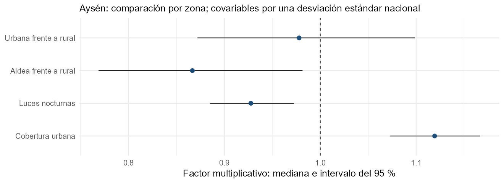

```{r setup, include=FALSE}
knitr::read_chunk("Rcode/Modelo_Chile.R")
knitr::opts_chunk$set(eval=FALSE, echo=TRUE, message=FALSE, warning=FALSE,
  comment="", fig.align="center", out.width="90%")
res <- readRDS("resultados/resumen.rds")
```

# Del Poisson al modelo de Chile

## Lo que aprenderemos en esta sesión

En D2S4 ajustamos un Poisson con personas, viviendas y zona. Ahora incorporaremos información satelital y diferencias entre comunas y segmentos.

1. Reconocer qué datos utiliza el modelo y qué población puede representar.
2. Entender sus componentes y localizarlos en Stan.
3. Preparar y ejecutar una demostración regional.
4. Interpretar resultados y reconocer decisiones pendientes.

El recorrido es guiado para personal técnico censal que comienza con modelos bayesianos y Stan.

## Un problema conocido por el equipo censal

Dos segmentos con las mismas viviendas ocupadas pueden tener distinta población por:

- Su tipo de zona y sus características territoriales.
- Diferencias entre comunas que las covariables no describen por completo.
- Diferencias propias de cada segmento, aun dentro de una comuna.

**Pregunta guiada:** ¿cuáles de estas diferencias podrían describir con información censal y cuáles necesitan fuentes complementarias?

## La idea central del modelo

**Personas esperadas = viviendas ocupadas × personas esperadas por vivienda.**

La relación personas/vivienda depende de zona, covariables satelitales, comuna y una variación propia del segmento.

| Componente | Papel |
|---|---|
| Poisson | Describe conteos de personas alrededor de un valor esperado |
| Lognormal | Permite una relación positiva y variable entre personas y viviendas |
| Efecto de comuna | Representa diferencias compartidas por segmentos de la misma comuna |

No supone que cada vivienda tenga el mismo número de personas.

## Dos niveles para leer con ayuda del docente

$$
Y_i\mid\delta_i\sim\operatorname{Poisson}(V_i\delta_i),\qquad
\log\delta_i\sim N(\mathbf{x}_i^\top\boldsymbol\beta+\gamma_{g(i)},\sigma^2).
$$

- $Y_i$: personas censadas; $V_i$: viviendas particulares ocupadas.
- $\delta_i$: relación latente personas/vivienda; se aprende a partir de los datos.
- $\mathbf{x}_i\boldsymbol\beta$: zona y covariables; $\gamma_{g(i)}$: efecto de la comuna.
- $\sigma$: variación entre segmentos que no explica el predictor.

La fórmula expresa la estructura conceptual. El archivo operativo añade límites a la intensidad; los revisaremos más adelante.

::: {.notes}
Distinguir delta descriptiva (cociente observado o completado en preparación) de delta latente. El predictor en escala log es la mediana condicional de la densidad: exp(eta) no es su media marginal, que sin topes es exp(eta+sigma^2/2). No exigir derivaciones a participantes.
:::

## Qué significa «jerárquico» aquí

Los efectos de comuna se relacionan mediante una distribución común:

$$
\gamma_g\sim N(0,\sigma_U^2).
$$

Esto permite compartir información **entre comunas dentro del ajuste regional**. Las comunas con menos información dependen más de esa estructura común.

En el flujo regional, cada región tiene su propio ajuste. No hay aprendizaje compartido entre regiones mediante un único conjunto nacional de parámetros.

**Comprueben:** región de ajuste y agrupamiento de efectos aleatorios son dos decisiones diferentes.

# Del censo a las entradas del modelo

## El flujo de trabajo del proyecto

| Paso | Qué produce |
|---|---|
| 01 · Revisión de insumos | Diccionario y completitud de covariables |
| 02 · Estandarización | Covariables en unidades comparables, con referencia nacional |
| 03 · Preparación censal | Clasificación, exposición, densidad descriptiva y elegibilidad |
| 04 · Ajuste regional | Parámetros y simulaciones posteriores |
| 05 · Predicción | Resultados por segmento y agregados bajo una configuración documentada |

La información censal se valida **antes** del ajuste. Stan no sustituye la revisión de llaves, universos y coherencia de conteos.

## Dos conjuntos que no debemos confundir

| Conjunto | Para qué se usa | En Stan |
|---|---|---|
| Aptos | Aprender la relación entre personas, viviendas y covariables | Sufijo `_obs` |
| Destino de predicción | Aplicar la relación aprendida en un universo definido | Sufijo `_tot` |

La predicción puede incluir segmentos no usados para ajustar. Esto exige justificar que la relación aprendida pueda trasladarse a ellos.

**Actividad breve:** identifiquen una razón por la que un segmento puede quedar fuera del ajuste sin desaparecer del universo de interés.

## Elegibilidad: una decisión metodológica

La preparación del proyecto marca aptos a los segmentos sin colectivas, con densidad descriptiva definida y mayor de una persona por vivienda.

- La densidad descriptiva puede haberse completado con información de edificaciones.
- La elegibilidad **no exige por sí sola cobertura completa** ni garantiza datos sin error.
- Para el ajuste de esta demostración verificamos además viviendas ocupadas positivas.
- Seleccionar por densidad puede afectar la representatividad de la relación aprendida.

No se modifican los filtros solo para mejorar el resultado. Cualquier cambio exige documentar la decisión y revisar su efecto.

::: {.notes}
Fuente: funciones/fun_preparacion_segmentos.R, calcular_elegibilidad_modelo(). Completar delta con edificios no significa que ese conteo ya haya sustituido V_obs en Stan. Verificar la exposición efectiva y su coherencia con la fuente antes de ajustar. No afirmar que todos los aptos son segmentos de cobertura completa.
:::

## Exposición: ajuste y predicción

| Entrada | Significado |
|---|---|
| `V_obs` | Viviendas ocupadas observadas en los aptos, usadas en la relación con `Y_obs` |
| `V_tot` | Viviendas utilizadas para predecir en el conjunto destino |

Si se adopta un escenario de cobertura $c$, puede definirse $V^{tot}=\operatorname{round}(VPO/c)$: por ejemplo, 90 viviendas y $c=0,90$ dan 100.

El valor de $c$ necesita respaldo. Una banda de cobertura no es automáticamente una tasa exacta, y ajustar viviendas no resuelve por sí solo la omisión de personas.

## Qué aporta la información satelital

En la demostración utilizaremos dos covariables ya estandarizadas:

| Variable | Información que resume |
|---|---|
| `nlav_mean_std` | Luces nocturnas |
| `dyn_world_urb_mean_std` | Señal de cobertura urbana de Dynamic World |

Se añaden a los indicadores de zona. Una covariable no reemplaza las viviendas del modelo ni demuestra una relación causal con la población.

La selección corta permite seguir el código. **No reproduce la selección completa ni los resultados del ajuste nacional.**

## Conservar la estandarización de origen

Las columnas `_std` del taller ya emplean la referencia nacional.

- No se vuelven a estandarizar dentro de Aysén.
- El coeficiente expresa el cambio asociado a **una desviación estándar nacional**, manteniendo las demás entradas.
- Las matrices de ajuste y predicción deben tener idénticas columnas y orden.

**Pregunta:** ¿qué ocurriría si una columna tuviera una escala distinta al ajustar y al predecir?

# Demostración regional en R y Stan

## Un solo recorrido para esta sesión

Abran `Rcode/Modelo_Chile.R` y `stan/modelo_poblacion_v02.stan` en la carpeta de D3S3.

La demostración usa **Aysén**, comuna como agrupamiento, zona como efecto fijo y dos covariables. Conserva el programa Stan actual del proyecto, copiado sin modificar sus distribuciones previas ni sus topes.

**Para predecir:** se restringe el destino a segmentos sin colectivas y con viviendas ocupadas positivas; se usa la exposición observada ($c=1$). No representa toda la región ni una corrección de cobertura.

::: {.notes}
La base procede de Taller/Dia3_S3_Implementacion/data/segmentos_aysen.rds. Programa Stan procedente de la raíz del proyecto, no de la copia histórica del taller: las previas difieren entre ambas. Los originales se conservan. Sesión anterior de referencia: Taller/Dia4_S1_Modelo_Chile/Modelo_Chile.qmd.
:::

## Revisar cuántos segmentos utilizamos

```{r, eval=TRUE, echo=FALSE}
knitr::kable(res$resumen_datos, col.names=c("Conjunto", "Segmentos"))
```

En `chile-datos`, revisen las llaves `edid`–`fid`, los conteos y los filtros.

**Actividad guiada:** expliquen por qué el destino no coincide con la base completa y por qué el conjunto de aptos cumple una función distinta.

## Construir X y Z sin perder correspondencias

- `X`: intercepto, indicadores de aldea y urbana, y dos covariables. Rural es la referencia.
- `Z`: una columna por comuna; cada fila señala a qué comuna pertenece el segmento.
- El diccionario de comunas se define una vez; se utiliza en aptos y destino.
- Las filas conservan el orden de los conteos y de las llaves censales.

**En R:** ejecuten `chile-matrices`, lean la tabla de aptos por comuna y verifiquen que cada fila de `Z` suma uno.

::: {.notes}
No interpretar rango(X) completo como garantía de identificabilidad conjunta de X y Z: con indicadores completos de comuna e intercepto existe una dependencia que la distribución jerárquica regulariza. No repetir zona como efecto fijo si se escoge zona como agrupamiento. Grupos sin aptos obtendrían efectos desde la estructura previa jerárquica y requieren identificación explícita.
:::

## Entregar las entradas a Stan {.smaller}

```{r chile-lista}
```

**Localicen:** número de aptos, tamaño del destino, columnas de `X`, comunas y exposición de cada conjunto.

## Leer los bloques del archivo Stan

| Bloque | Qué buscamos |
|---|---|
| `data` | Conteos, viviendas, matrices y techo de densidad |
| `parameters` | Coeficientes, efectos de comuna, escalas y densidad latente de cada apto |
| `transformed parameters` | Predictor y media del conteo con límites operativos |
| `model` | Distribuciones previas y relación con el censo |
| `generated quantities` | Conteos predictivos para el destino |

**Actividad:** localicen una entrada conocida del censo y un parámetro que Stan debe aprender. ¿Cuál es la diferencia?

## Las líneas que conectan el modelo con el censo

```stan
lp = X_obs * beta + Z_obs * gamma;
Y_obs ~ poisson(lambda);
densidad ~ lognormal(lp, sigma);
```

- `lp` combina zona, covariables y comuna.
- `densidad` permite que cada segmento se aparte de ese predictor.
- `lambda` combina densidad y viviendas para formar el conteo esperado.

**Comparen con D2S4:** ¿qué nuevo componente permite representar diferencias entre segmentos de una misma zona?

## Distribuciones previas del archivo actual

```stan
beta   ~ normal(0, 100);
gamma  ~ normal(0, sigmaU);
sigma  ~ cauchy(0, 2.5);
sigmaU ~ normal(0, 10);
```

Las restricciones positivas de `sigma` y `sigmaU` dejan solo la parte positiva de esas distribuciones.

Estas previas son amplias. Se conservan para leer el programa actual; **no se presentan como una elección ya validada**. Su sensibilidad y el comportamiento predictivo previo deben revisarse antes de una aplicación institucional.

::: {.notes}
La copia histórica del taller usa beta ~ normal(0,1) y sigmaU ~ normal(0,1), mientras el Stan de la raíz usa escalas 100 y 10. No mezclar cifras históricas con esta nueva demostración ni afirmar equivalencia numérica. La distribución previa regulariza la separación entre intercepto y efectos, pero no aporta identificabilidad a la verosimilitud por sí sola.
:::

## Límites del programa: decisiones que afectan resultados

| Regla | Consecuencia |
|---|---|
| Intensidad del conteo entre 1 y $10^7$ | Evita valores fuera del rango operativo; modifica la especificación conceptual |
| Densidad predictiva limitada a `delta_max = 4.35` | Reduce valores altos; requiere justificar el umbral y estudiar sensibilidad |
| Piso de intensidad igual a 1 | Con cero viviendas, el programa generaría en promedio una persona |

En esta demostración se excluyen del destino los segmentos con cero viviendas y los que tienen colectivas. Su tratamiento sigue siendo una tarea necesaria para definir el universo completo.

::: {.notes}
El techo es una operación min(lognormal_rng(...), delta_max): acumula masa en el umbral, no es una lognormal truncada y renormalizada. El umbral 4,35 es el p99 nacional histórico utilizado en los materiales, no un límite universal de densidad. No calificar como imposible una densidad superior sin evidencia. Los segmentos excluidos deben recibir tratamiento específico y conciliación de universos; no deben desaparecer del total institucional.
:::

## Compilar y ajustar: dos acciones distintas {.smaller}

```{r chile-ajuste}
```


- `stan_model()` compila una vez el programa.
- `sampling()` aprende los parámetros con los datos de esta demostración.
- Los valores iniciales ayudan a empezar el cálculo: no sustituyen las distribuciones previas.

::: {.notes}
Realizar la demostración con el entorno verificado antes de la sesión. Cada cadena guarda 1500 simulaciones posteriores: 6000 en total, dependientes entre sí. Tiempo de compilación y muestreo varía por computador. No lanzar el flujo nacional desde la clase ni instalar paquetes automáticamente. La práctica autónoma se desarrolla en D3S4.
:::

## Primera lectura de los controles

```{r, eval=TRUE, echo=FALSE}
a <- res$controles
knitr::kable(a, digits=4, col.names=c("R-hat máximo", "ESS bulk mínimo",
  "ESS tail mínimo", "Divergencias", "Límite de profundidad", "Revisar"))
```

Guía: R-hat menor de 1,01; ESS bulk y tail al menos 400; cero divergencias y cero llegadas al límite. Se revisan también intercepto, efectos de comuna y escalas.

Si `Revisar` es verdadero, las predicciones quedan pendientes de revisión. Un buen diagnóstico de cálculo tampoco garantiza adecuación del modelo. Ambos temas se profundizan el día 4.

# Interpretación y uso de resultados

## Leer los coeficientes en una escala comprensible

{width=88%}

Cada punto es la mediana de `exp(beta)` y cada línea su intervalo del 95 %. Un factor superior a uno aumenta la mediana condicional de personas/vivienda; uno inferior a uno la reduce.

Para zona se compara con rural; para covariables, el cambio es por una desviación estándar nacional, manteniendo comuna y demás entradas.

::: {.notes}
La figura no muestra el intercepto ni los gamma. Los factores también multiplican la media no acotada si sigma se mantiene, pero las predicciones con pisos/topes ya no siguen necesariamente ese cambio proporcional. Evitar interpretar como efecto causal o como aporte de población que pueda sumarse directamente.
:::

## Una interpretación para practicar

Elijan una covariable y completen:

«Manteniendo zona, comuna y las demás entradas, aumentar una desviación estándar nacional en ___ se asocia a multiplicar la mediana de personas por vivienda por ___. El intervalo del factor va de ___ a ___.»

Después respondan: ¿por qué ese resultado no demuestra que la covariable cause un cambio en la población?

**Producto breve:** una interpretación con números tomados del ajuste y una limitación.

## Qué predice `generated quantities`

Para cada segmento destino y cada simulación:

1. Calcula el predictor con sus covariables y su comuna.
2. Genera una nueva densidad lognormal y aplica el techo.
3. Combina esa densidad con las viviendas de predicción.
4. Genera un conteo Poisson.

Es una **predicción con nueva variación de segmento**, incluso si ese segmento fue apto. No reutiliza automáticamente su densidad latente aprendida en el ajuste.


## Agregar sin perder la incertidumbre

Para obtener un total, primero sumamos segmentos **dentro de cada simulación** y luego resumimos esa colección de totales.

```r
y_tot <- as.matrix(ajuste, pars = "Y_tot")
total_draw <- rowSums(y_tot)
quantile(total_draw, c(0.025, 0.5, 0.975))
```

No se suman los límites inferiores y superiores de los intervalos por segmento. Estos conteos comparten parámetros y no son independientes sin condicionar en ellos.

El total de esta demostración corresponde solo al destino definido, no a toda la población de Aysén.

## Una comparación que exige verificar el universo

```{r, eval=TRUE, echo=FALSE}
t <- res$resumen_total
knitr::kable(t[c("censado_mismo_subconjunto", "media_predictiva", "inferior", "superior")],
  digits=0, col.names=c("Censado en el destino", "Media predictiva", "Límite 2,5 %", "Límite 97,5 %"),
  format.args=list(big.mark=".", scientific=FALSE))
```

**Solo como demostración del flujo.** Si el ajuste está marcado para revisión, esta comparación no se usa para concluir sobre población.

Una diferencia con el conteo censal **no identifica por sí sola omisión**: intervienen selección de aptos, especificación, población cubierta, exposición y reglas de predicción.

## Qué cambia y qué exige volver a ajustar

| Cambio | Acción necesaria |
|---|---|
| Solo exposición del destino, con parámetros y muestra de ajuste fijos | Regenerar predicciones bajo el nuevo escenario |
| Aptos, conteos observados o exposición de ajuste | Volver a ajustar y revisar |
| Covariables, agrupamiento o distribuciones previas | Volver a ajustar y revisar |
| Universo de destino | Revisar matrices, grupos y comparabilidad antes de predecir |

Los escenarios de cobertura y su incertidumbre se trabajarán con más detalle el día 4.

# Del ejemplo al trabajo institucional

## Ajuste regional y agrupamiento: código actual

El proyecto distingue dos recorridos:

| Recorrido | Agrupamiento dentro de cada ajuste regional |
|---|---|
| Regional histórico | Una sola etiqueta regional: separación entre efecto e intercepto muy dependiente de las previas |
| Generalizado | Comuna (`cut`), zona u otra variable categórica definida explícitamente |

El script generalizado usa `cut` como agrupamiento predeterminado. Si se elige zona como agrupamiento, desactiva sus indicadores fijos para evitar repetirlos.

No se mezclan cadenas de recorridos, agrupamientos o selecciones de covariables diferentes.


## Qué registrar con cada ajuste

- Versión del archivo Stan y de la base de entrada.
- Llaves y universo de ajuste y predicción.
- Columnas de `X`, niveles y orden de `Z`, referencia de estandarización.
- Agrupamiento, exposición, cobertura y techo de densidad.
- Distribuciones previas, semilla y configuración de cadenas.
- Diagnósticos completos y resultados de validación.

El script de la sesión guarda esa configuración junto con resultados y entorno. Las reglas deben poder explicarse a un equipo que no participó en el ajuste.

## Preparación para D3S4

En parejas, antes de iniciar la práctica siguiente:

1. Señalen dónde se entregan las personas y viviendas a Stan.
2. Expliquen qué representan `X`, `Z`, `densidad` y `sigma`.
3. Identifiquen qué universo cubren las predicciones.
4. Propongan una verificación censal y un chequeo del modelo.

## Muchas gracias

**Andrés Gutiérrez · Stalyn Guerrero**

**Contacto: Andrés Gutiérrez**  
[andres.gutierrez@cepal.org](mailto:andres.gutierrez@cepal.org)
