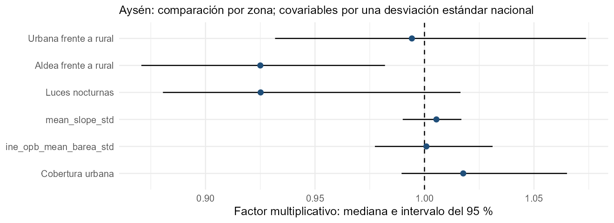

```{r setup, include=FALSE}
knitr::read_chunk("Rcode/Modelo_Chile.R")
knitr::opts_chunk$set(eval=FALSE, echo=TRUE, message=FALSE, warning=FALSE,
  comment="", fig.align="center", out.width="90%")
res <- readRDS("resultados/resumen.rds")
```

# Del Poisson al modelo de Chile

## Referencia del modelo final de Chile

Se conserva la especificación implementada: **40 covariables, zona fija y efectos de comuna**, con matrices y exposición originales.

**Estado del ajuste guardado:** presenta problemas fuertes de convergencia. Las cifras permiten reproducir y revisar el procedimiento. Su uso para inferir población queda pendiente de validación.

La sesión de diagnóstico conserva todas las alertas. Los escenarios posteriores son ejercicios de cálculo sobre esa misma referencia.

## Lo que aprenderemos en esta sesión

En D2S4 ajustamos un Poisson con personas, viviendas y zona. Ahora incorporaremos información satelital y diferencias entre comunas y segmentos.

1. Reconocer qué datos utiliza el modelo y qué población puede representar.
2. Entender sus componentes y localizarlos en Stan.
3. Preparar y ejecutar una demostración regional.
4. Interpretar resultados y reconocer decisiones pendientes.

El recorrido es guiado para personal técnico censal que comienza con modelos bayesianos y Stan.

## Un problema conocido por el equipo censal

Dos segmentos con las mismas viviendas ocupadas pueden tener distinta población por:

- Su tipo de zona y sus características territoriales.
- Diferencias entre comunas que las covariables no describen por completo.
- Diferencias propias de cada segmento, aun dentro de una comuna.

**Pregunta guiada:** ¿cuáles de estas diferencias podrían describir con información censal y cuáles necesitan fuentes complementarias?

## La idea central del modelo

**Personas esperadas = viviendas ocupadas × personas esperadas por vivienda.**

La relación personas/vivienda depende de zona, covariables satelitales, comuna y una variación propia del segmento.

| Componente | Papel |
|---|---|
| Poisson | Describe conteos de personas alrededor de un valor esperado |
| Lognormal | Permite una relación positiva y variable entre personas y viviendas |
| Efecto de comuna | Representa diferencias compartidas por segmentos de la misma comuna |

No supone que cada vivienda tenga el mismo número de personas.

## Dos niveles para leer con ayuda del docente

$$
Y_i\mid\delta_i\sim\operatorname{Poisson}(V_i\delta_i),\qquad
\log\delta_i\sim N(\mathbf{x}_i^\top\boldsymbol\beta+\gamma_{g(i)},\sigma^2).
$$

- $Y_i$: personas censadas; $V_i$: viviendas particulares ocupadas.
- $\delta_i$: relación latente personas/vivienda; se aprende a partir de los datos.
- $\mathbf{x}_i\boldsymbol\beta$: zona y covariables; $\gamma_{g(i)}$: efecto de la comuna.
- $\sigma$: variación entre segmentos que no explica el predictor.

La fórmula expresa la estructura conceptual. El archivo operativo añade límites a la intensidad; los revisaremos más adelante.


## Qué significa «jerárquico» aquí

Los efectos de comuna se relacionan mediante una distribución común:

$$
\gamma_g\sim N(0,\sigma_U^2).
$$

Esto permite compartir información **entre comunas dentro del ajuste regional**. Las comunas con menos información dependen más de esa estructura común.

En el flujo regional, cada región tiene su propio ajuste. No hay aprendizaje compartido entre regiones mediante un único conjunto nacional de parámetros.

**Comprueben:** región de ajuste y agrupamiento de efectos aleatorios son dos decisiones diferentes.

# Del censo a las entradas del modelo

## El flujo de trabajo del proyecto

| Paso | Qué produce |
|---|---|
| 01 · Revisión de insumos | Diccionario y completitud de covariables |
| 02 · Estandarización | Covariables en unidades comparables, con referencia nacional |
| 03 · Preparación censal | Clasificación, exposición, densidad descriptiva y elegibilidad |
| 04 · Ajuste regional | Parámetros y simulaciones posteriores |
| 05 · Predicción | Resultados por segmento y agregados bajo una configuración documentada |

La información censal se valida **antes** del ajuste. Stan no sustituye la revisión de llaves, universos y coherencia de conteos.

## Dos conjuntos que no debemos confundir

| Conjunto | Para qué se usa | En Stan |
|---|---|---|
| Aptos | Aprender la relación entre personas, viviendas y covariables | Sufijo `_obs` |
| Destino de predicción | Aplicar la relación aprendida en un universo definido | Sufijo `_tot` |

La predicción puede incluir segmentos no usados para ajustar. Esto exige justificar que la relación aprendida pueda trasladarse a ellos.

**Actividad breve:** identifiquen una razón por la que un segmento puede quedar fuera del ajuste sin desaparecer del universo de interés.

## Elegibilidad: una decisión metodológica

La preparación del proyecto marca aptos a los segmentos sin colectivas, con densidad descriptiva definida y mayor de una persona por vivienda.

- La densidad descriptiva puede haberse completado con información de edificaciones.
- La elegibilidad **no exige por sí sola cobertura completa** ni garantiza datos sin error.
- Para el ajuste de esta demostración verificamos además viviendas ocupadas positivas.
- Seleccionar por densidad puede afectar la representatividad de la relación aprendida.

No se modifican los filtros solo para mejorar el resultado. Cualquier cambio exige documentar la decisión y revisar su efecto.


## Exposición: ajuste y predicción

| Entrada | Significado |
|---|---|
| `V_obs` | Viviendas ocupadas observadas en los aptos, usadas en la relación con `Y_obs` |
| `V_tot` | Viviendas utilizadas para predecir en el conjunto destino |

Si se adopta un escenario de cobertura $c$, puede definirse $V^{tot}=\operatorname{round}(VPO/c)$: por ejemplo, 90 viviendas y $c=0,90$ dan 100.

El valor de $c$ necesita respaldo. Una banda de cobertura no es automáticamente una tasa exacta, y ajustar viviendas no resuelve por sí solo la omisión de personas.

## Qué aporta la información satelital

Se utilizan las **40 covariables estandarizadas del ajuste final**, además de zona y comuna. Dos ejemplos son:

| Variable | Información que resume |
|---|---|
| `nlav_mean_std` | Luces nocturnas |
| `dyn_world_urb_mean_std` | Señal de cobertura urbana de Dynamic World |

Se añaden a los indicadores de zona. Una covariable no reemplaza las viviendas del modelo ni demuestra una relación causal con la población.

La selección corta permite seguir el código. **No reproduce la selección completa ni los resultados del ajuste nacional.**

## Conservar la estandarización de origen

Las columnas `_std` del taller ya emplean la referencia nacional.

- No se vuelven a estandarizar dentro de Aysén.
- El coeficiente expresa el cambio asociado a **una desviación estándar nacional**, manteniendo las demás entradas.
- Las matrices de ajuste y predicción deben tener idénticas columnas y orden.

**Pregunta:** ¿qué ocurriría si una columna tuviera una escala distinta al ajustar y al predecir?

# Demostración regional en R y Stan

## Un solo recorrido para esta sesión

Abran `Rcode/Modelo_Chile.R` y `stan/modelo_poblacion_v02.stan` en la carpeta de D3S3.

La demostración usa **Aysén**, comuna como agrupamiento, zona como efecto fijo y las 40 covariables finales. Conserva el programa Stan actual del proyecto, copiado sin modificar sus distribuciones previas ni sus topes.

**Para predecir:** se conservan las mismas llaves, matrices y exposición `V_tot` del ajuste final. La base regional contiene 2.085 segmentos y 1.455 aptos. Los resultados del muestreo original requieren revisión antes de inferir población.


## Revisar cuántos segmentos utilizamos

```{r, eval=TRUE, echo=FALSE}
knitr::kable(res$resumen_datos, col.names=c("Conjunto", "Segmentos"))
```

En `chile-datos`, revisen las llaves `edid`–`fid`, los conteos y los filtros.

**Actividad guiada:** expliquen por qué el destino no coincide con la base completa y por qué el conjunto de aptos cumple una función distinta.

## Construir X y Z sin perder correspondencias

- `X`: intercepto, indicadores de urbana y aldea, y 40 covariables (43 columnas). Rural es la referencia.
- `Z`: una columna por comuna; cada fila señala a qué comuna pertenece el segmento.
- El diccionario de comunas se define una vez; se utiliza en aptos y destino.
- Las filas conservan el orden de los conteos y de las llaves censales.

**En R:** ejecuten `chile-matrices`, lean la tabla de aptos por comuna y verifiquen que cada fila de `Z` suma uno.

## Revisar la colinealidad del diseño final

La matriz original tiene **43 columnas y rango 42** en Aysén y Magallanes. Se conserva sin eliminar variables para reproducir lo implementado.

Comparen columnas de vialidad y revisen dependencias lineales. Relacionen esta evidencia con los coeficientes extremos, las trazas y los diagnósticos.

**Tarea:** propongan qué revisarían en una nueva especificación. Esa revisión produciría otro ajuste y debe documentarse por separado.


## Entregar las entradas a Stan

```{r chile-lista}
```

**Localicen:** número de aptos, tamaño del destino, columnas de `X`, comunas y exposición de cada conjunto.

## Leer los bloques del archivo Stan

| Bloque | Qué buscamos |
|---|---|
| `data` | Conteos, viviendas, matrices y techo de densidad |
| `parameters` | Coeficientes, efectos de comuna, escalas y densidad latente de cada apto |
| `transformed parameters` | Predictor y media del conteo con límites operativos |
| `model` | Distribuciones previas y relación con el censo |
| `generated quantities` | Conteos predictivos para el destino |

**Actividad:** localicen una entrada conocida del censo y un parámetro que Stan. ¿Cuál es la diferencia?

## Las líneas que conectan el modelo con el censo

```stan
lp = X_obs * beta + Z_obs * gamma;
Y_obs ~ poisson(lambda);
densidad ~ lognormal(lp, sigma);
```

- `lp` combina zona, covariables y comuna.
- `densidad` permite que cada segmento se aparte de ese predictor.
- `lambda` combina densidad y viviendas para formar el conteo esperado.


## Distribuciones previas del archivo actual

```stan
beta   ~ normal(0, 100);
gamma  ~ normal(0, sigmaU);
sigma  ~ cauchy(0, 2.5);
sigmaU ~ normal(0, 10);
```

Las restricciones positivas de `sigma` y `sigmaU` dejan solo la parte positiva de esas distribuciones.

Estas previas son amplias. Se conservan para leer el programa actual; **no se presentan como una elección ya validada**. Su sensibilidad y el comportamiento predictivo previo deben revisarse antes de una aplicación institucional.


## Límites del programa: decisiones que afectan resultados

| Regla | Consecuencia |
|---|---|
| Intensidad del conteo entre 1 y $10^7$ | Evita valores fuera del rango operativo; modifica la especificación conceptual |
| Densidad predictiva limitada a `delta_max = 4.35` | Reduce valores altos; requiere justificar el umbral y estudiar sensibilidad |
| Piso de intensidad igual a 1 | Con cero viviendas, el programa generaría en promedio una persona |

Se conserva el universo del proyecto, incluidos los casos con exposición cero. El piso de intensidad también se conserva: identifiquen cuántos casos afecta y evalúen su consecuencia. Reproducir esta regla no valida su adecuación ni resuelve la población colectiva.


## Compilar y ajustar: dos acciones distintas

```{r chile-ajuste}
```


- `stan_model()` compila una vez el programa.
- `sampling()` aprende los parámetros con los datos de esta demostración.
- Los valores iniciales ayudan a empezar el cálculo: no sustituyen las distribuciones previas.


## Primera lectura de los controles

```{r, eval=TRUE, echo=FALSE}
a <- res$controles
knitr::kable(a, digits=4, col.names=c("R-hat máximo", "ESS bulk mínimo",
  "ESS tail mínimo", "Divergencias", "Límite de profundidad", "Revisar"))
```

Guía: R-hat menor de 1,01; ESS bulk y tail al menos 400; cero divergencias y cero llegadas al límite. Se revisan también intercepto, efectos de comuna y escalas.

Si `Revisar` es verdadero, las predicciones quedan pendientes de revisión. Un buen diagnóstico de cálculo tampoco garantiza adecuación del modelo. Ambos temas se profundizan el día 4.

# Interpretación y uso de resultados

## Leer los coeficientes en una escala comprensible

{width=88%}

La figura muestra cuatro términos para facilitar su lectura. Los 42 términos sin intercepto están en resultados/factores_completos.csv. Cada punto es la mediana de `exp(beta)` y cada línea su intervalo del 95 %. Un factor superior a uno aumenta la mediana condicional de personas/vivienda; uno inferior a uno la reduce.

Para zona se compara con rural; para covariables, el cambio es por una desviación estándar nacional, manteniendo comuna y demás entradas.


## Qué predice `generated quantities`

Para cada segmento destino y cada simulación:

1. Calcula el predictor con sus covariables y su comuna.
2. Genera una nueva densidad lognormal y aplica el techo.
3. Combina esa densidad con las viviendas de predicción.
4. Genera un conteo Poisson.

Es una **predicción con nueva variación de segmento**, incluso si ese segmento fue apto. No reutiliza automáticamente su densidad latente aprendida en el ajuste.


## Agregar sin perder la incertidumbre

Para obtener un total, primero sumamos segmentos **dentro de cada simulación** y luego resumimos esa colección de totales.

```r
y_tot <- final$Y_tot # Cantidades generadas originales
total_draw <- rowSums(y_tot)
quantile(total_draw, c(0.025, 0.5, 0.975))
```

No se suman los límites inferiores y superiores de los intervalos por segmento. Estos conteos comparten parámetros y no son independientes sin condicionar en ellos.

El total utiliza el universo regional del ajuste final. Su interpretación poblacional requiere validar el muestreo, las reglas de exposición y la conciliación con población colectiva.

## Una comparación que exige verificar el universo

```{r, eval=TRUE, echo=FALSE}
t <- res$resumen_total
knitr::kable(t[c("censado_mismo_subconjunto", "media_predictiva", "inferior", "superior")],
  digits=0, col.names=c("Censado en el destino", "Media predictiva", "Límite 2,5 %", "Límite 97,5 %"),
  format.args=list(big.mark=".", scientific=FALSE))
```

**Solo como demostración del flujo.** Si el ajuste está marcado para revisión, esta comparación no se usa para concluir sobre población.

Una diferencia con el conteo censal **no identifica por sí sola omisión**: intervienen selección de aptos, especificación, población cubierta, exposición y reglas de predicción.

## Qué cambia y qué exige volver a ajustar

| Cambio | Acción necesaria |
|---|---|
| Solo exposición del destino, con parámetros y muestra de ajuste fijos | Regenerar predicciones bajo el nuevo escenario |
| Aptos, conteos observados o exposición de ajuste | Volver a ajustar y revisar |
| Covariables, agrupamiento o distribuciones previas | Volver a ajustar y revisar |
| Universo de destino | Revisar matrices, grupos y comparabilidad antes de predecir |

Los escenarios de cobertura y su incertidumbre se trabajarán con más detalle el día 4.

# Del ejemplo al trabajo institucional

## Qué registrar con cada ajuste

- Versión del archivo Stan y de la base de entrada.
- Llaves y universo de ajuste y predicción.
- Columnas de `X`, niveles y orden de `Z`, referencia de estandarización.
- Agrupamiento, exposición, cobertura y techo de densidad.
- Distribuciones previas, semilla y configuración de cadenas.
- Diagnósticos completos y resultados de validación.

El script de la sesión guarda esa configuración junto con resultados y entorno. Las reglas deben poder explicarse a un equipo que no participó en el ajuste.

## Muchas gracias

**Andrés Gutiérrez · Stalyn Guerrero**

**Contacto: Andrés Gutiérrez**  
[andres.gutierrez@cepal.org](mailto:andres.gutierrez@cepal.org)
