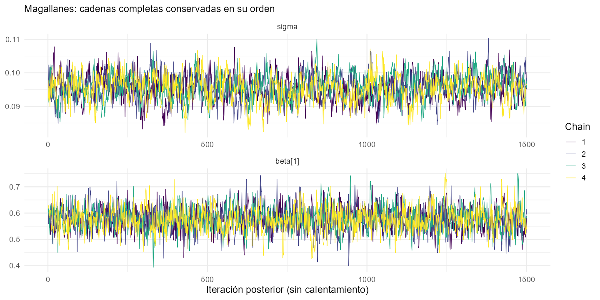
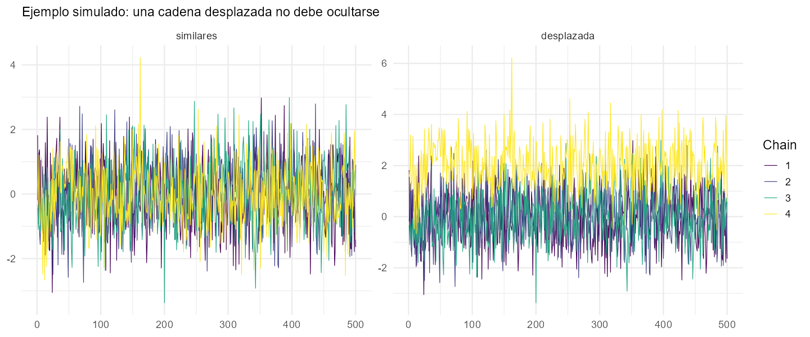
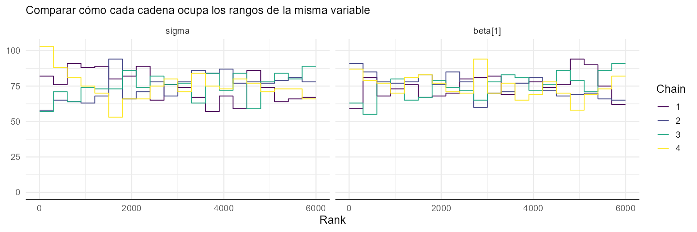
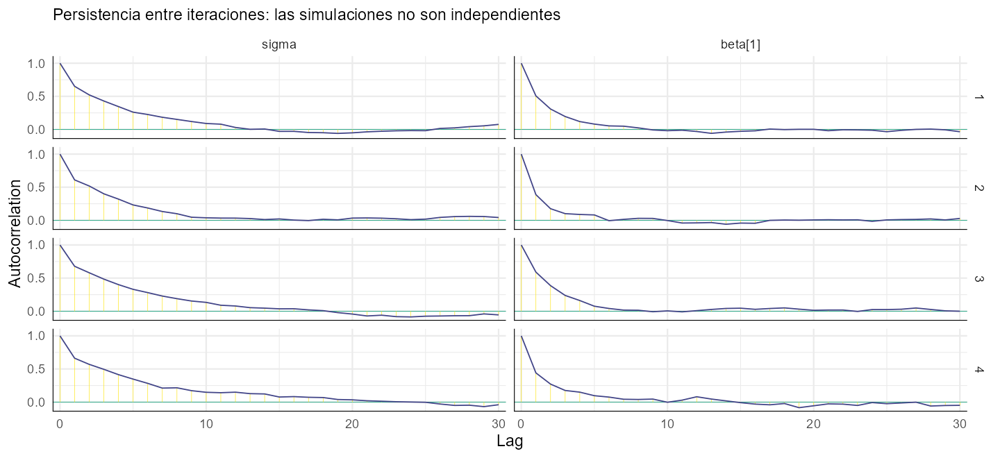
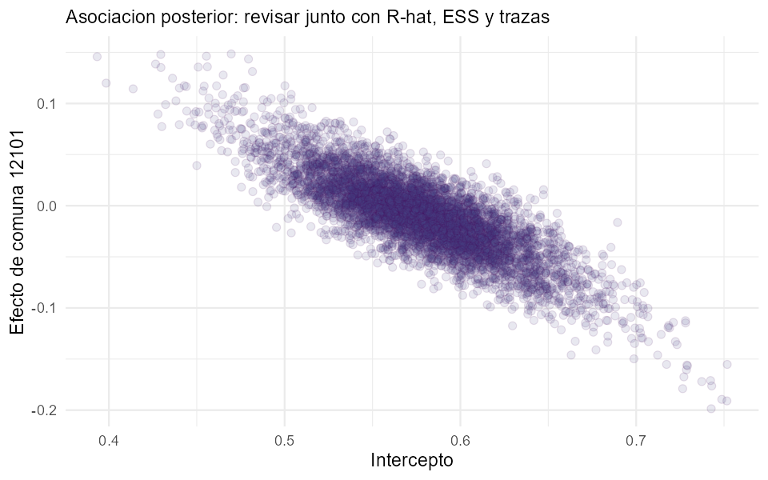
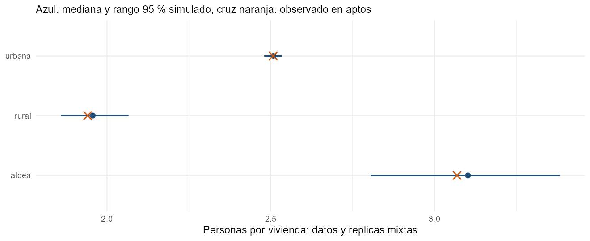

```{r setup, include=FALSE}
knitr::read_chunk("Rcode/Diagnostico.R")
knitr::opts_chunk$set(eval=FALSE, echo=TRUE, message=FALSE, warning=FALSE,
  comment="", fig.align="center", out.width="90%")
res <- readRDS("resultados/resumen.rds")
```

# Antes de utilizar una estimación

## El problema de hoy

En D3S4 ajustamos un modelo de población por segmentos de Magallanes. Que Stan haya terminado no basta para utilizar sus resultados.

Hoy distinguiremos:

1. **Cálculo:** ¿las cadenas exploraron de forma suficientemente estable?
2. **Modelo:** ¿reproduce aspectos relevantes de los datos?
3. **Información censal:** ¿variables, exposición y universo son adecuados para el uso propuesto?

El trabajo es guiado y de nivel intermedio. No requiere derivar los diagnósticos ni modificar el algoritmo de Stan.

## Qué material vamos a revisar

Usaremos una **nueva ejecución controlada de la especificación de D3S4**: Magallanes, dos covariables, zona fija y efectos de comuna.

- Mismo archivo Stan y configuración de muestreo; no son resultados nacionales.
- Se conservan todas las iteraciones posteriores de los coeficientes y escalas, separadas por cadena, y los diagnósticos del muestreador.
- El diagnóstico y los chequeos no vuelven a ajustar Stan en clase.

Las diferencias pequeñas con las tablas anteriores pueden deberse a la nueva ejecución y sus valores iniciales. Se diagnostica este ajuste, sin trasladar automáticamente la aprobación de otro.

::: {.notes}
D3S4 guardaba resúmenes y 1000 simulaciones seleccionadas para predicción, no las cadenas completas ni energy__. Esta revisión las regenera con la misma especificación; no reconstruye ni inventa las cadenas originales. No se modifican los resultados publicados de D3S4. El archivo nuevo registra semilla R y Stan, hash del modelo, configuración y orden de columnas/grupos.
:::

## Archivos y preparación

Abran `Rcode/Diagnostico.R` desde la carpeta `Dia4_S1_Diagnostico`.

```{r diagnostico-paquetes}
```

Ejecuten por bloques con apoyo del docente. `data/ajuste_magallanes.rds` contiene las cadenas y los datos necesarios.

`Rcode/Preparar_cadenas_docente.R` sirve para regenerar ese insumo antes de la sesión; no es un ejercicio obligatorio ni debe lanzarse durante la exposición.

# Controles del cálculo

## Conservar la estructura de las cadenas

```{r diagnostico-cargar}
```

El arreglo tiene tres dimensiones: **iteraciones posteriores × cadenas × variables**.

No se deben mezclar las cadenas antes de calcular R-hat y ESS ni confundir simulaciones posteriores con calentamiento. Un archivo de medianas e intervalos no permite recuperar trazas.

**Pregunta:** ¿por qué una tabla con 6000 filas, sin saber a qué cadena pertenece cada una, es insuficiente para algunos diagnósticos?

## Cuatro cadenas que deberían contar la misma historia

Las cadenas exploran la distribución posterior desde recorridos distintos.

- Pueden mostrar valores diferentes en una iteración concreta.
- Buscamos que describan una distribución común, sin separaciones ni tendencias persistentes.
- Miles de simulaciones no equivalen a miles de observaciones censales nuevas.

**Distinción:** la incertidumbre del modelo y la imprecisión causada por una simulación finita son dos cosas distintas.

## Una guía numérica para esta capacitación

| Control | Qué queremos observar |
|---|---|
| R-hat | Menor de 1,01 y próximo a uno |
| ESS bulk y tail | Al menos 400 en el conjunto de las cuatro cadenas |
| Divergencias posteriores | Cero; cualquier aparición requiere revisión |
| Límite de profundidad | Investigar si se alcanza repetidamente |
| E-BFMI por cadena | Valores inferiores a 0,3 señalan una alerta |

Son criterios de revisión, no un certificado de que la estimación censal sea correcta. Véase la [guía de diagnósticos de Stan](https://mc-stan.org/learn-stan/diagnostics-warnings.html).

::: {.notes}
La profundidad máxima afecta especialmente a eficiencia; no equivale por sí sola a sesgo por divergencias. La guía de esta capacitación marca para revisión cualquier llegada al límite como política conservadora, pero el tratamiento depende de su frecuencia y de otros diagnósticos. Los umbrales son orientación; la precisión requerida depende de las cantidades y decisiones concretas.
:::

## R-hat: comparar recorridos

R-hat compara el comportamiento entre cadenas y dentro de ellas. La versión que calcula `posterior` usa rangos y cadenas divididas para detectar diferencias de posición y escala.

No necesitamos calcularlo a mano.

- Cercano a uno es una señal favorable de estabilidad.
- Un valor alto obliga a revisar el recorrido de las cadenas.
- Un valor cercano a uno no descarta por sí solo un modelo inadecuado.

Referencia: [documentación de R-hat en posterior](https://mc-stan.org/posterior/reference/rhat.html).

## ESS y error de Monte Carlo

- **ESS bulk:** información efectiva para describir la parte central de la distribución.
- **ESS tail:** información efectiva sobre sus colas; importante al comunicar intervalos.
- **MCSE de la media:** imprecisión numérica de la media calculada con un número finito de simulaciones.

ESS no es el número de segmentos ni una medida de calidad del censo. Más iteraciones pueden mejorar precisión cuando el muestreo funciona, pero no reparan datos mal definidos o un modelo insuficiente.

**Actividad:** localicen una variable con menor ESS y comparen su MCSE con su desviación posterior.

## Calcular y leer la tabla de parámetros

```{r diagnostico-tabla}
```

Se incluyen intercepto, covariables, efectos de comuna y escalas. No retiramos los parámetros difíciles para obtener una tabla más favorable.

**En pareja:** identifiquen el mayor R-hat, el menor ESS tail y cuántos parámetros requieren revisión.

## Resultados del ajuste que estamos diagnosticando

```{r, eval=TRUE, echo=FALSE}
t <- res$parameters
knitr::kable(data.frame(
  Parametros=nrow(t),
  Rhat_max=max(t$rhat), ESS_bulk_min=min(t$ess_bulk),
  ESS_tail_min=min(t$ess_tail), Requieren_revision=sum(t$revisar)), digits=4)
```

La tabla resume los coeficientes y escalas guardados. No incluye un diagnóstico individual de cada densidad latente de segmento.

**Pregunta:** ¿qué parte de la evaluación sigue pendiente aunque toda esta tabla cumpla las guías?

## Advertencias del muestreador, cadena por cadena

Ejecuten `diagnostico-nuts`.

```{r, eval=TRUE, echo=FALSE}
knitr::kable(res$nuts, digits=3,
  col.names=c("Cadena", "Divergencias", "Límite de profundidad", "E-BFMI", "Revisar"))
```

E-BFMI ayuda a detectar dificultades para recorrer niveles de energía. No necesitamos interpretar físicamente la energía ni memorizar su fórmula.

Se conservan los resultados por cadena: un promedio puede ocultar una cadena problemática.

## Qué hacer ante una alerta

| Señal | Primera revisión |
|---|---|
| Divergencias | Geometría del modelo, escalas, previas y parametrización; ajustes del algoritmo con apoyo del docente |
| R-hat alto o trazas separadas | Recorridos, inicialización, parámetros relacionados y duración |
| ESS bajo sin otras alertas | Persistencia y precisión requerida; valorar más simulaciones |
| Profundidad elevada | Eficiencia, escalamiento y estructura del modelo |
| E-BFMI bajo | Energías por cadena, escalas y parametrización |

No existe un único cambio de configuración que resuelva todos los problemas. Se documenta la causa propuesta y se repite la revisión después de actuar.

# Leer los gráficos

## Trazas: mirar antes de concluir

{width=75%}

Cada color es una cadena; el eje horizontal conserva el orden posterior.

**Actividad:** busquen separación, tendencias o periodos largos sin explorar otras zonas. Comparen lo que ven con R-hat y ESS de las mismas variables.

## Un contraste artificial para aprender

{width=80%}

**Ejemplo simulado; no corresponde al censo ni al ajuste de Magallanes.** En un panel las cadenas son similares; en el otro, una está desplazada.

**En pareja:** identifiquen el panel problemático. ¿Sería correcto borrar esa cadena y presentar las otras tres?

::: {.notes}
No quitar una cadena por incomodidad. Investigar causas, verificar ejecución/datos y decidir si corresponde repetir un ajuste corregido. El ejemplo desplaza artificialmente la cuarta cadena; no pretende reproducir un problema específico del modelo de población ni representar un ajuste Bayesiano válido.
:::

## Qué dicen los números del ejemplo

```{r, eval=TRUE, echo=FALSE}
knitr::kable(res$example, digits=3,
  col.names=c("Ejemplo artificial", "R-hat", "ESS bulk", "ESS tail"))
```

La tabla ayuda a conectar la señal visual con sus indicadores. El R-hat favorable del ejemplo similar no lo convierte en evidencia sobre el modelo censal real.

## Rangos: otra forma de comparar cadenas

{width=85%}

Si todas describen una distribución común, esperamos ocupación comparable de rangos. Diferencias persistentes entre colores merecen revisión.

Este gráfico complementa las trazas: no sustituye el resto de los controles.

## Autocorrelación: por qué las simulaciones no son independientes

{width=80%}

El eje horizontal indica separación entre iteraciones. Persistencia alta durante muchos pasos ayuda a explicar un ESS bajo.

**Decisión:** eliminar filas para que el gráfico parezca menos correlacionado no aumenta la información disponible. Conservamos las cadenas completas para diagnosticar.

## Pares: reconocer parámetros relacionados

{width=65%}

El intercepto y un efecto de comuna pueden compensarse parcialmente. Una nube alargada muestra asociación posterior; por sí sola no demuestra que el muestreo haya fallado.

En el ajuste histórico con una única etiqueta regional, separar ese efecto del intercepto dependía especialmente de las previas. Aquí el agrupamiento es comuna.

::: {.notes}
No extrapolar el problema Q=1 del flujo histórico a una prueba de fallo automático en el modelo generalizado. El intercepto y el conjunto completo de indicadores de comuna tienen una dependencia en la verosimilitud; las previas jerárquicas regularizan la separación. Las correlaciones se evalúan junto a mezcla, precisión y cantidades de interés. No se presenta SVD ni derivaciones de rango como requisito del público.
:::

# Del cálculo a los datos censales

## Un buen muestreo puede describir mal el censo

Aun con buenos controles, debemos preguntar:

- ¿La exposición corresponde a viviendas ocupadas y al universo pertinente?
- ¿La selección de aptos afecta la relación que aprenderemos?
- ¿Las covariables y los efectos representan las diferencias territoriales relevantes?
- ¿El modelo reproduce dispersión, valores extremos y contrastes por zona o comuna?

Un cambio de algoritmo no corrige por sí solo estas decisiones.

## Qué vamos a contrastar con los datos

Conservamos zona, covariables, comuna y viviendas de los **segmentos aptos**. Generamos nuevos conteos con nueva variación de segmento.

Esto permite preguntar si la estructura del modelo reproduce tasas y variación entre segmentos de ese diseño.

- Es una réplica mixta, no una reconstrucción condicionada en la densidad particular aprendida de cada segmento.
- Usa datos del ajuste: **no es validación fuera de muestra**.
- No pretende representar colectivas, segmentos excluidos ni toda la región.

::: {.notes}
Los parámetros globales se toman de la posterior; se generan efectos nuevos de segmento mediante una densidad lognormal. Esta elección del nivel de réplica define la pregunta de comprobación. Un chequeo condicionado en densidades latentes aprendidas respondería otra pregunta y requiere guardarlas; no inventar esos valores a partir de medianas. La selección de aptos depende de una densidad descriptiva superior a uno; las réplicas no vuelven a imponer ese filtro. Una discrepancia puede reflejar selección y estructura del modelo: investigar ambas, sin presentar el chequeo como una prueba formal concluyente.
:::

## No confundir la regla de ajuste con el techo de predicción

En el archivo de la práctica:

| Regla | Dónde se aplica |
|---|---|
| Piso 1 y techo $10^7$ para la intensidad | En la relación con los conteos y en la predicción |
| Techo `delta_max` para la densidad | En la predicción operativa, no en la densidad del ajuste |

Las réplicas del chequeo mantienen los límites de intensidad del ajuste, **sin añadir el techo predictivo de densidad**. De otro modo mezclaríamos dos reglas diferentes.

El efecto del techo predictivo y de los escenarios de cobertura se retoma en D4S2.

## Ejecutar las réplicas y los chequeos

Ejecuten `diagnostico-replicas` y `diagnostico-chequeos` con apoyo del docente.

No hace falta reescribir las funciones. Identifiquen:

1. Qué datos permanecen fijos.
2. Qué componentes se simulan nuevamente.
3. Qué cantidad se compara con la observada.

Usamos una selección de 500 simulaciones para estos gráficos. Los diagnósticos R-hat y ESS anteriores utilizan **todas** las iteraciones posteriores, sin esa selección.

## Comparar personas por vivienda según zona

{width=82%}

Azul: mediana y rango del 95 % de las réplicas. Cruz naranja: cociente observado de personas/viviendas de los aptos de cada zona.

**Actividad:** identifiquen dónde la referencia está dentro o fuera del rango. Propongan una verificación censal y una posible limitación del modelo.

## Comprobar también la variación entre segmentos

```{r, eval=TRUE, echo=FALSE}
knitr::kable(res$spread_check, digits=3,
  col.names=c("Desviación observada", "Límite 2,5 %", "Mediana replicada", "Límite 97,5 %"))
```

Se compara la desviación de los cocientes personas/vivienda de los segmentos aptos. No es la incertidumbre de una estimación de población total.

En este ajuste, la desviación observada queda **`r if (res$spread_check$observado >= res$spread_check$inferior && res$spread_check$observado <= res$spread_check$superior) "dentro" else "fuera"`** del rango de las réplicas. Si queda fuera, investiguen selección de aptos, estructura del modelo y estabilidad del chequeo antes de concluir.

Acertar promedios no garantiza reproducir la variación ni las colas. Las viviendas escasas de algunos segmentos también influyen en estos cocientes.

## Una señal requiere una investigación concreta

| Lo que encontramos | Qué revisar |
|---|---|
| Desajuste en una zona | Definición de zona, viviendas, composición y covariables |
| Más variación observada que replicada | Heterogeneidad no representada, extremos o errores de información |
| Exceso de variación replicada | Escala del modelo, covariables y nivel de réplica elegido |
| Diferencias concentradas en no aptos | Transferibilidad; los chequeos de aptos no los validan |

No declaramos automáticamente «omisión» a partir de una discrepancia ni «modelo validado» por un gráfico favorable.

## Qué necesitaría una validación más exigente

Para evaluar predicción debemos reservar información y comprobar el desempeño fuera del ajuste, con una partición adecuada al uso territorial.

- Evitar que segmentos estrechamente relacionados entren a entrenamiento y validación sin evaluar esa dependencia.
- Definir la cantidad y el universo que se van a contrastar.
- Revisar errores e intervalos por grupos relevantes, no solo el total.
- Usar información independiente de cobertura cuando exista.

En esta sesión no se presenta una prueba fuera de muestra como si ya estuviera realizada.

# Decidir y documentar

## Tres situaciones que exigen acciones diferentes

| Situación | Acción |
|---|---|
| Cálculo con alertas | Investigar y corregir antes de confiar en la inferencia |
| Cálculo estable, chequeo insuficiente | Revisar especificación, datos o nivel de réplica |
| Cálculo y chequeos favorables | Continuar con validación y escenarios; documentar límites |

La aprobación de los controles numéricos es una parte del recorrido, no su final.

## Fuentes de consulta

- [Stan: diagnósticos y advertencias](https://mc-stan.org/learn-stan/diagnostics-warnings.html).
- [posterior: R-hat moderno](https://mc-stan.org/posterior/reference/rhat.html).
- [bayesplot: gráficos del muestreador NUTS](https://mc-stan.org/bayesplot/reference/MCMC-nuts.html).
- Código del proyecto y especificación de D3S3–D3S4 de esta revisión.

## Muchas gracias

**Andrés Gutiérrez · Stalyn Guerrero**

**Contacto: Andrés Gutiérrez**  
[andres.gutierrez@cepal.org](mailto:andres.gutierrez@cepal.org)
