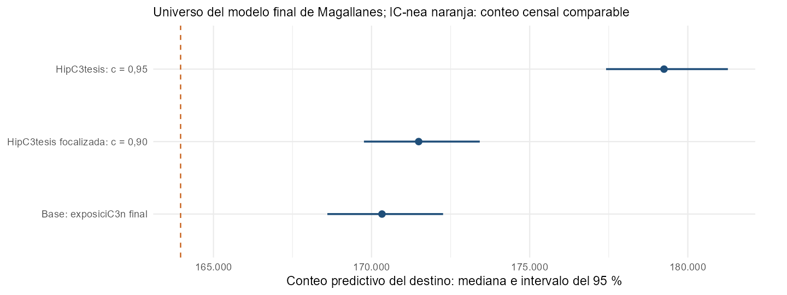
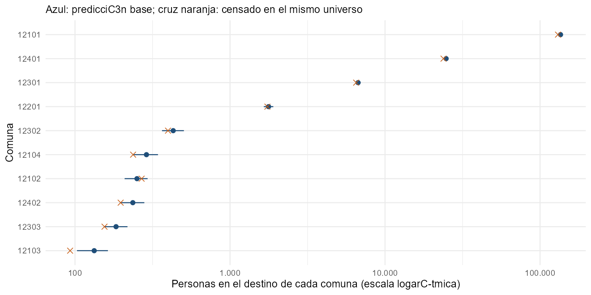

```{r setup, include=FALSE}
knitr::read_chunk("Rcode/Prediccion.R")
knitr::read_chunk("Rcode/funciones_prediccion.R")
knitr::opts_chunk$set(eval=FALSE, echo=TRUE, message=FALSE, warning=FALSE,
  comment="", fig.align="center", out.width="90%")
res <- readRDS("resultados/resumen.rds")
nacional <- readRDS("resultados/prediccion_chile.rds")
```

# De las cadenas a una predicción utilizable

## Qué haremos en esta sesión

En D4S1 revisamos el cálculo y su relación con los datos. Ahora aprenderemos a:

1. Generar conteos por segmento desde las cadenas conservadas.
2. Distinguir intensidad del conteo y conteo predictivo.
3. Incorporar supuestos de cobertura sin confundirlos con datos observados.
4. Agregar las réplicas por comuna, por región y para el destino nacional del modelo.

El recorrido es guiado para personal técnico censal. No volveremos a ajustar Stan: utilizaremos el modelo que ya aprendimos a ejecutar.


## Lo que ya sabemos y lo que sigue pendiente

D4S1 encontró alertas de muestreo en las 16 regiones, incluido Magallanes. Los chequeos predictivos también mostraron discrepancias entre el modelo y los datos.

Por eso esta sesión es una **demostración de predicción**, no la presentación de un resultado poblacional validado.

Usaremos las réplicas guardadas para aprender a agregar. Antes de usar las cifras se deben revisar el muestreo, el modelo, la selección de aptos y el alcance del destino.

## Un universo que debe permanecer explícito

La demostración incluye **`r res$destino_segmentos` segmentos destino** de Magallanes, sin colectivas y con viviendas particulares ocupadas positivas. El ajuste utilizó **`r res$ajuste_segmentos` segmentos aptos**.

- El destino puede contener segmentos que no fueron aptos para ajustar.
- Los resultados no corresponden a toda la población regional.
- La transferencia a no aptos necesita justificación y validación.

Antes de informar un total regional completo deben resolverse los segmentos excluidos y la población en colectivas, con universos coherentes y sin doble conteo.

# Insumos y correspondencias

## Materiales que vamos a utilizar

Abran `Rcode/Prediccion.R` desde la carpeta `Dia4_S2_Prediccion`.

```{r prediccion-paquetes}
```

Las cadenas y sus controles se leen de la sesión **D4S1**. El destino local conserva las llaves, matrices y datos definidos en D3S4, sin reutilizar sus simulaciones de parámetros.

Para ejecutar R, mantengan las carpetas de la revisión en su estructura original. 

## Verificar antes de predecir

Ejecuten `prediccion-insumos` y revisen:

| Componente | Comprobación |
|---|---|
| Modelo | Firma y configuración compatibles con las cadenas |
| `X_tot` | Columnas, escala y orden iguales a los del ajuste |
| `Z_tot` | Mismo diccionario y orden de comunas |
| Segmentos | Llaves únicas y filas alineadas con sus matrices |
| Aptos que están en el destino | Mismos conteos, viviendas y matrices del ajuste |

No se unen matrices y censos simplemente porque tengan el mismo número de filas.

## Qué representan las simulaciones posteriores

Cada fila seleccionada contiene un conjunto coherente de coeficientes, efectos de comuna y escalas.

Usaremos **`r res$configuracion$n_draws` simulaciones** repartidas por las cadenas para limitar memoria al predecir. Los diagnósticos de D4S1 utilizaron las cadenas completas.

No se calcula cada segmento con una mediana aislada de los parámetros: hacerlo pierde variación y relaciones entre ellos.

**Actividad:** localicen en `prediccion-draws` cómo se extraen `beta`, `gamma` y `sigma` de las mismas filas.

# Predicción por segmento

## Un recorrido de cinco pasos

Para cada simulación y segmento:

1. Combinar covariables y efecto de su comuna.
2. Generar una nueva relación personas/vivienda con variación de segmento.
3. Aplicar el techo de densidad de la regla predictiva.
4. Multiplicar por las viviendas del escenario y aplicar los límites de intensidad.
5. Simular un conteo de personas con la distribución Poisson.

La predicción conserva las reglas del programa de la práctica. Modificar una de ellas cambia el resultado y debe documentarse.

## Usar todos los efectos de comuna

```r
eta <- beta %*% t(X_tot) + gamma %*% t(Z_tot)
```

Cada segmento recibe el efecto que corresponde a su comuna. El diccionario y el orden de `Z_tot` son esenciales.

**Preguntas guiadas:**

1. ¿Qué ocurriría si se aplicara `gamma[1]` a todos los segmentos?
2. ¿Qué tratamiento necesitaría una comuna que no existe en el diccionario del ajuste?

No se asigna un grupo desconocido al primero de la lista ni se crea un efecto sin justificarlo.

## Qué significa generar una nueva densidad

La predicción del programa genera nueva variación de segmento, incluso cuando el segmento fue apto.

Esto no equivale a reutilizar la densidad latente particular aprendida de su conteo censal ni a reconstruir automáticamente una población «verdadera».

La pregunta que responde es: **¿qué conteos puede generar esta estructura bajo las características y la exposición del destino?**

Antes de una aplicación institucional debe justificarse que esa pregunta corresponde al objetivo de estimación.

## Los límites de la regla operativa

| Regla | Efecto |
|---|---|
| Densidad limitada a `delta_max = 4.35` | Reduce la cola predictiva alta |
| Intensidad entre 1 y $10^7$ | Impone piso y techo al valor esperado del conteo |
| Redondeo de viviendas ampliadas | Puede modificar pequeñas exposiciones |

El techo de densidad es una referencia histórica del taller, no un límite universal de personas por vivienda. Requiere revisión de sensibilidad y justificación.

En esta ejecución, **`r format(round(res$cap_pct, 3), nsmall=3)` %** de las densidades generadas supera el techo antes de aplicarlo.


## Intensidad simulada y conteo predictivo

| Cantidad | Qué incorpora |
|---|---|
| `lambda` | Valor esperado del conteo dado el estado simulado de densidad y exposición |
| `y` | Añade la variación Poisson de un conteo nuevo |

La intensidad ya varía por las réplicas de la distribución posterior de los parámetros y la nueva densidad de segmento: su intervalo no representa únicamente incertidumbre sobre coeficientes.

**Actividad:** ¿cuál de los dos intervalos utilizarían para describir la variación de un nuevo conteo de personas?

## Leer la función de apoyo

```{r prediccion-funcion}
```

La función recibe una cobertura por segmento. 

`qpois()` transforma números aleatorios uniformes en conteos Poisson. 


## Un ejemplo por segmento

```{r, eval=TRUE, echo=FALSE}
e <- res$ejemplos_segmentos
knitr::kable(e[c("n_vpo", "intensidad_inferior", "intensidad_superior", "inferior", "superior")],
  digits=0, col.names=c("Viviendas", "Intensidad: 2,5 %", "Intensidad: 97,5 %", "Conteo: 2,5 %", "Conteo: 97,5 %"))
```

Son tres segmentos del escenario base con diferentes cantidades de viviendas.

**Interpreten:** el intervalo del conteo incluye una fuente adicional de variación. No se exige que su ancho supere estrictamente al otro en toda realización finita de una simulación.

# Escenarios de cobertura

## Qué exposición se modifica

Para un supuesto de cobertura de viviendas $c_i$:

$$
V_i^{tot}=\operatorname{round}(VPO_i/c_i).
$$

- $c_i$ se refiere a viviendas ocupadas, no a cobertura de personas.
- Si $c_i=1$, se mantiene la exposición observada.
- Si $c_i<1$, se amplía esa exposición bajo el supuesto adoptado.

No se cambia `V_obs` ni se vuelve a aprender la relación del modelo cuando solo se modifica la exposición del destino.

## Tres escenarios para comparar

```{r prediccion-escenarios}
```

- **Base:** exposición observada.
- **Uniforme:** supuesto de 0,95 para todo el destino.
- **Focalizado:** supuesto de 0,90 únicamente en segmentos clasificados como Incompleta; uno en los demás.

Son **hipótesis de aprendizaje**, no tasas estimadas de cobertura de Magallanes. La clasificación censal por sí sola no determina ese valor.

## Alinear una cobertura externa por llaves

Ejecuten `prediccion-llaves`. El bloque prepara una tabla intencionalmente desordenada y vuelve a alinearla usando `edid` y `fid`.

1. ¿Por qué ordenar solo por comuna no basta?
2. ¿Qué problemas debemos detectar si faltan segmentos o se repiten llaves?
3. ¿Qué hacemos con coberturas faltantes, iguales a cero o superiores a uno?

La función de apoyo detiene el cálculo ante esos errores. Un valor faltante no se reemplaza silenciosamente por cobertura completa.

## Qué suponen los escenarios

Se supone que la relación aprendida de personas/vivienda es aplicable a la exposición añadida.

Los intervalos consideran la variación del modelo y de los conteos, pero tratan los valores de cobertura como fijos. **No incorporan incertidumbre sobre esos valores ni toda la incertidumbre metodológica.**

**En pareja:** identifiquen información censal, de terreno o independiente que permita defender una cobertura distinta de uno en un segmento.

## Comparar el mismo destino

```{r, eval=TRUE, echo=FALSE}
t <- res$escenarios
knitr::kable(t[c("escenario", "viviendas", "mediana", "inferior", "superior", "cambio_mediana_pct")],
  digits=c(0,0,0,0,0,1), col.names=c("Escenario", "Viviendas", "Mediana", "Límite 2,5 %", "Límite 97,5 %", "Cambio frente a base (%)"),
  format.args=list(big.mark=".", decimal.mark=",", scientific=FALSE))
```

El porcentaje compara medianas de escenarios con la base. No se interpreta como una tasa de omisión censal.

**Preguntas:** ¿qué escenario cambia más viviendas? ¿Por qué el escenario focalizado no afecta a todo el destino por igual?

## Leer los escenarios en un gráfico

{width=82%}

Todos los resultados mantienen las mismas llaves destino. La referencia naranja es el conteo censal de ese mismo subconjunto.

La proximidad al censo o un intervalo más estrecho no bastan para seleccionar un escenario: debemos justificar los supuestos y revisar la adecuación del modelo.

## Cuándo hace falta volver a ajustar

| Cambio | Acción |
|---|---|
| Solo cobertura o exposición predictiva del mismo destino | Regenerar predicciones |
| Aptos, personas o viviendas utilizadas en el ajuste | Ajustar nuevamente y revisar |
| Covariables, agrupamiento o distribuciones previas | Ajustar nuevamente y revisar |
| Nuevos segmentos o grupos | Verificar matrices, disponibilidad de efectos y alcance de la extrapolación |

La separación entre ajuste y predicción ahorra trabajo, pero no elimina la revisión metodológica.

# Agregación e incertidumbre

## La regla fundamental para sumar

Primero sumamos los conteos de los segmentos **dentro de cada simulación**. Después calculamos medianas e intervalos de esos totales.

```r
selected_commune <- "12101"
columns <- as.character(destino$cut) == selected_commune
total_commune <- rowSums(base_y[, columns, drop = FALSE])
quantile(total_commune, c(0.025, 0.5, 0.975))
```

Ejecuten el bloque `prediccion-agregar` del script. Elijan otra comuna cambiando `selected_commune` por un código presente en el destino. Verifiquen el número de segmentos y el conteo censal con el mismo filtro.

## Por qué no sumamos extremos de intervalos

Los segmentos comparten coeficientes, efectos de comuna y escalas. Sus predicciones no son independientes sin condicionar en esos componentes.

```{r, eval=TRUE, echo=FALSE}
a <- res$agregacion
knitr::kable(data.frame(
  Metodo=c("Sumar extremos de segmentos", "Sumar por simulación y luego resumir"),
  Inferior=c(a$limite_inferior_suma_segmentos, a$limite_inferior_total_correcto),
  Superior=c(a$limite_superior_suma_segmentos, a$limite_superior_total_correcto)),
  digits=0, format.args=list(big.mark=".", decimal.mark=",", scientific=FALSE))
```

La segunda fila conserva la dependencia del modelo. Las medias son aditivas; medianas y extremos de intervalos no tienen por qué serlo.

## Predicciones por comuna

{width=75%}

Cada comuna aparece solo con los segmentos de nuestro destino. La escala horizontal es logarítmica para mostrar grupos de tamaños muy distintos.

**Actividad:** elijan una comuna y expliquen su intervalo sin presentarlo como población completa de esa comuna ni como un diagnóstico automático de omisión.

## Del segmento a otros niveles territoriales

El mismo procedimiento permite agrupar por comuna, zona u otra clasificación, conservando el orden de las simulaciones y las llaves.

Para formar un total regional completo debemos resolver los universos excluidos. Para agregar regiones, además se necesita una construcción conjunta coherente con su dependencia o independencia en el modelo. A continuación sumaremos una réplica de cada región y calcularemos los intervalos a partir de esas sumas.

## Actividad: repetir la predicción en otra región

Descompriman el paquete de la práctica. En RStudio, fijen como directorio de trabajo la carpeta que contiene `Rcode/` y `data/regiones/`.

```r
Sys.setenv(CHL2026_REGION = "05")  # Valparaíso
source("Rcode/Predecir_una_region.R", encoding = "UTF-8")
```

1. Cambien el código para elegir cualquier región, de `"01"` a `"16"`. El script indica qué región y cuántos segmentos del destino está usando.
2. Ejecuten la predicción base y el escenario de cobertura del 95 %. Para probar otro supuesto, cambien `cobertura` en el script.
3. Comparen las medianas y los intervalos del 95 % para la región y para sus zonas rural, aldea y urbana. Expliquen qué supuesto cambió.

## Qué reproduce el ejercicio regional

- **Base original de Stan.** R vuelve a resumir las 2.000 réplicas guardadas del total regional.
- **Base en R.** R simula conteos por segmento a partir de los parámetros ya ajustados y suma dentro de cada réplica.
- **Escenario en R.** R repite el cálculo con la exposición modificada. Usa los mismos números aleatorios para comparar los escenarios.

La base en R genera conteos nuevos. Se comparan sus resúmenes con los originales de Stan. Todo el ejercicio funciona con **R base** y los archivos regionales incluidos. Las alertas de D4S1 mantienen los resultados como preliminares.

## Cómo se forma una réplica nacional

1. Lean los totales simulados de las **16 regiones**. Cada total regional ya suma los segmentos de su destino dentro de una réplica.
2. Combinen al azar un total de cada región. El ejemplo trata los ajustes regionales como independientes. La combinación se repite hasta usar las 2.000 réplicas de cada región.
3. Sumen los 16 valores de cada combinación y agreguen el conteo fijo de 254.224 personas censadas sin segmento asignado. Calculen la mediana y el intervalo predictivo del 95 % sobre esos totales.

```{r}
source("Rcode/Prediccion_nacional.R", encoding = "UTF-8")
quantile(total_chile, c(0.025, 0.5, 0.975))
```

Los archivos regionales están en `data/regiones/`. La semilla fija permite repetir el emparejamiento. El número de cadena o de iteración de una región no vincula sus réplicas con las de otra.

## Predicción por región (01–08)

```{r, eval=TRUE, echo=FALSE}
tabla_regiones <- function(i) {
  knitr::kable(nacional$regiones[i, c("region", "observado", "mediana", "inferior", "superior")],
    col.names = c("Región", "Censado en el destino", "Mediana", "P2,5", "P97,5"),
    digits = 0, format.args = list(big.mark = ".", decimal.mark = ",", scientific = FALSE))
}
tabla_regiones(1:8)
```

Las cifras censadas y las predicciones corresponden a los mismos segmentos del destino de cada región.

## Predicción por región (09–16)

```{r, eval=TRUE, echo=FALSE}
tabla_regiones(9:16)
```

P2,5 y P97,5 se calculan con las réplicas de cada total regional. Para el intervalo de Chile se vuelven a calcular los percentiles después de sumar.

## Resultado nacional con el conteo sin segmento {#resultado-para-el-destino-nacional-del-modelo}

```{r, eval=TRUE, echo=FALSE}
campos <- c("observado", "media", "mediana", "inferior", "superior")
t <- rbind(nacional$pais_segmentos[campos], nacional$pais[campos])
t <- cbind(Componente = c("Segmentos destino", "Con censo sin segmento"), t)
knitr::kable(t, col.names = c("Universo", "Personas censadas", "Media", "Mediana", "P2,5", "P97,5"),
  digits = 0, format.args = list(big.mark = ".", decimal.mark = ",", scientific = FALSE))
```

- **Conteo fijo.** Se suman **254.224 personas censadas sin segmento asignado** a cada réplica nacional y al conteo censado de referencia, siguiendo el paso 07 del proyecto. El intervalo conserva su amplitud.
- **Alcance.** La predicción cubre los **196.647 segmentos del destino original**, incluidos 4.727 con exposición implementada igual a cero. El programa aplica un mínimo de 1 a su intensidad predictiva. Las alertas de convergencia mantienen el resultado como preliminar.

## Resultados por zona en las 16 regiones

```{r, eval=TRUE, echo=FALSE}
zonas <- readRDS("resultados/prediccion_por_zona.rds")$nacional
knitr::kable(zonas, col.names = c("Zona", "Segmentos", "Personas censadas", "Media de Stan",
  "P2,5 en R", "Mediana en R", "P97,5 en R"),
  digits = 0, format.args = list(big.mark = ".", decimal.mark = ",", scientific = FALSE))
```

La **media de Stan** suma las medias originales por segmento. Para obtener el intervalo y la mediana por zona, R genera conteos nuevos con los mismos parámetros y suma dentro de cada réplica. El conteo sin segmento se incorpora únicamente al total nacional. Para reproducir la tabla, ejecuten `Rcode/Prediccion_por_zona.R` después del script nacional.

# Interpretar y documentar

## Qué contiene y qué no contiene el intervalo

| Incluye en esta demostración | No queda resuelto por el intervalo |
|---|---|
| Variación en la distribución posterior de los parámetros | Error o incertidumbre de las coberturas fijadas |
| Nueva variación de segmento | Sesgo por selección de aptos o mala especificación |
| Variación Poisson de conteos | Población de los segmentos y universos excluidos |

Un intervalo estrecho puede coexistir con decisiones metodológicas débiles. Su interpretación depende del modelo, del destino y de las entradas adoptadas.

## Una lectura para un equipo censal

Respondan en pareja:

1. ¿Qué escenario eligieron y cómo modifica las viviendas utilizadas para predecir?
2. ¿Cuál es la mediana del total de personas y cuál es su intervalo predictivo?
3. ¿Qué evidencia necesitarían para justificar esa modificación de las viviendas?
4. ¿Qué problemas del ajuste deben resolverse antes de utilizar los resultados?

## Guardar resultados que se puedan revisar

Ejecuten `prediccion-guardar`.

El script conserva:

- Resultados por segmento con llaves, escenario y cobertura asumida.
- Resultados por comuna y resumen de escenarios.
- Totales por simulación, para volver a agregar sin perder incertidumbre.
- Configuración, correspondencias de matrices, semillas y firma del modelo.

No se mezclan parámetros de un ajuste con resultados de otro porque compartan el nombre de la región.


## Muchas gracias

**Andrés Gutiérrez · Stalyn Guerrero**

**Contacto: Andrés Gutiérrez**  
[andres.gutierrez@cepal.org](mailto:andres.gutierrez@cepal.org)
