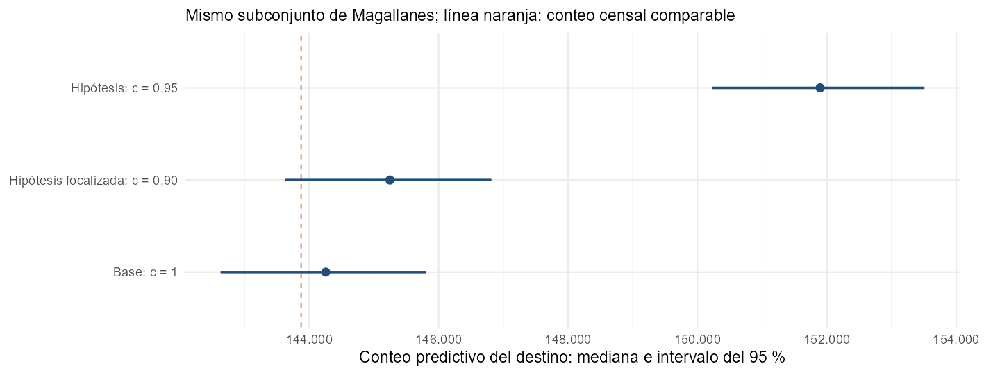
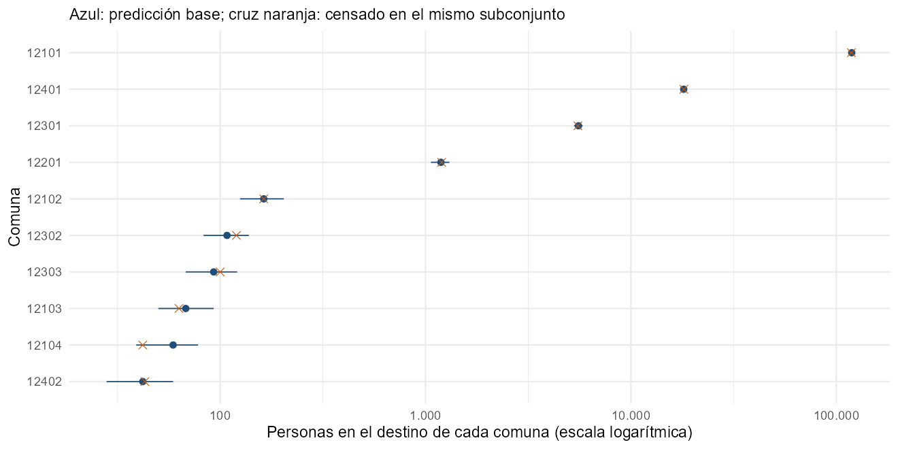

```{r setup, include=FALSE}
knitr::read_chunk("Rcode/Prediccion.R")
knitr::opts_chunk$set(eval=FALSE, echo=TRUE, message=FALSE, warning=FALSE,
  comment="", fig.align="center", out.width="90%")
res <- readRDS("resultados/resumen.rds")
```

# De las cadenas a una predicción utilizable

## Qué haremos en esta sesión

En D4S1 revisamos el cálculo y su relación con los datos. Ahora aprenderemos a:

1. Generar conteos por segmento desde las cadenas conservadas.
2. Distinguir intensidad del conteo y conteo predictivo.
3. Incorporar supuestos de cobertura sin confundirlos con datos observados.
4. Sumar simulaciones por comuna y comunicar sus intervalos.

El recorrido es guiado para personal técnico censal. No volveremos a ajustar Stan: utilizaremos el modelo que ya aprendimos a ejecutar.


## Lo que ya sabemos y lo que sigue pendiente

El ajuste conservado en D4S1 pasó los controles de cálculo de la capacitación. Los chequeos mostraron una pequeña discrepancia en la variación entre segmentos.

Por eso esta sesión es una **demostración de predicción**, no la presentación de un resultado poblacional validado.

Un cálculo estable permite continuar el análisis; la adecuación del modelo, la selección de aptos, los datos y la evaluación externa siguen formando parte de la revisión.

## Un universo que debe permanecer explícito

La demostración incluye **`r res$destino_segmentos` segmentos destino** de Magallanes, sin colectivas y con viviendas particulares ocupadas positivas. El ajuste utilizó **`r res$ajuste_segmentos` segmentos aptos**.

- El destino puede contener segmentos que no fueron aptos para ajustar.
- Los resultados no corresponden a toda la población regional.
- La transferencia a no aptos necesita justificación y validación.

Antes de informar un total regional completo deben resolverse los segmentos excluidos y la población en colectivas, con universos coherentes y sin doble conteo.

# Insumos y correspondencias

## Materiales que vamos a utilizar

Abran `Rcode/Prediccion.R` desde la carpeta `Dia4_S2_Prediccion`.

```{r prediccion-paquetes}
```

Las cadenas y sus controles se leen de la sesión **D4S1**. El destino local conserva las llaves, matrices y datos definidos en D3S4, sin reutilizar sus simulaciones de parámetros.

Para ejecutar R, mantengan las carpetas de la revisión en su estructura original. La presentación HTML puede abrirse por separado.

## Verificar antes de predecir

Ejecuten `prediccion-insumos` y revisen:

| Componente | Comprobación |
|---|---|
| Modelo | Firma y configuración compatibles con las cadenas |
| `X_tot` | Columnas, escala y orden iguales a los del ajuste |
| `Z_tot` | Mismo diccionario y orden de comunas |
| Segmentos | Llaves únicas y filas alineadas con sus matrices |
| Aptos que están en el destino | Mismos conteos, viviendas y matrices del ajuste |

No se unen matrices y censos simplemente porque tengan el mismo número de filas.

## Qué representan las simulaciones posteriores

Cada fila seleccionada contiene un conjunto coherente de coeficientes, efectos de comuna y escalas.

Usaremos **`r res$configuracion$n_draws` simulaciones** repartidas por las cadenas para limitar memoria al predecir. Los diagnósticos de D4S1 utilizaron las cadenas completas.

No se calcula cada segmento con una mediana aislada de los parámetros: hacerlo pierde variación y relaciones entre ellos.

**Actividad:** localicen en `prediccion-draws` cómo se extraen `beta`, `gamma` y `sigma` de las mismas filas.

# Predicción por segmento

## Un recorrido de cinco pasos

Para cada simulación y segmento:

1. Combinar covariables y efecto de su comuna.
2. Generar una nueva relación personas/vivienda con variación de segmento.
3. Aplicar el techo de densidad de la regla predictiva.
4. Multiplicar por las viviendas del escenario y aplicar los límites de intensidad.
5. Simular un conteo de personas con la distribución Poisson.

La predicción conserva las reglas del programa de la práctica. Modificar una de ellas cambia el resultado y debe documentarse.

## Usar todos los efectos de comuna

```r
eta <- beta %*% t(X_tot) + gamma %*% t(Z_tot)
```

Cada segmento recibe el efecto que corresponde a su comuna. El diccionario y el orden de `Z_tot` son esenciales.

**Preguntas guiadas:**

1. ¿Qué ocurriría si se aplicara `gamma[1]` a todos los segmentos?
2. ¿Qué tratamiento necesitaría una comuna que no existe en el diccionario del ajuste?

No se asigna un grupo desconocido al primero de la lista ni se crea un efecto sin justificarlo.

## Qué significa generar una nueva densidad

La predicción del programa genera nueva variación de segmento, incluso cuando el segmento fue apto.

Esto no equivale a reutilizar la densidad latente particular aprendida de su conteo censal ni a reconstruir automáticamente una población «verdadera».

La pregunta que responde es: **¿qué conteos puede generar esta estructura bajo las características y la exposición del destino?**

Antes de una aplicación institucional debe justificarse que esa pregunta corresponde al objetivo de estimación.

## Los límites de la regla operativa

| Regla | Efecto |
|---|---|
| Densidad limitada a `delta_max = 4.35` | Reduce la cola predictiva alta |
| Intensidad entre 1 y $10^7$ | Impone piso y techo al valor esperado del conteo |
| Redondeo de viviendas ampliadas | Puede modificar pequeñas exposiciones |

El techo de densidad es una referencia histórica del taller, no un límite universal de personas por vivienda. Requiere revisión de sensibilidad y justificación.

En esta ejecución, **`r format(round(res$cap_pct, 3), nsmall=3)` %** de las densidades generadas supera el techo antes de aplicarlo.

::: {.notes}
La operación min(densidad,delta_max) acumula masa en el límite; no es una lognormal truncada renormalizada. El piso de intensidad produciría, en promedio, una persona aun con cero viviendas: por eso el destino didáctico excluye esos casos, sin afirmar que su tratamiento institucional esté resuelto. En el ajuste, la densidad no tenía este techo predictivo, como se explicó en D4S1.
:::

## Intensidad simulada y conteo predictivo

| Cantidad | Qué incorpora |
|---|---|
| `lambda` | Valor esperado del conteo dado el estado simulado de densidad y exposición |
| `y` | Añade la variación Poisson de un conteo nuevo |

La intensidad ya varía por los parámetros posteriores y la nueva densidad de segmento: su intervalo no representa únicamente incertidumbre sobre coeficientes.

**Actividad:** ¿cuál de los dos intervalos utilizarían para describir la variación de un nuevo conteo de personas?

## Leer la función de apoyo

```{r prediccion-funcion}
```

La función recibe una cobertura por segmento. El docente acompaña la lectura; no necesitan reescribir el algoritmo.

`qpois()` transforma números aleatorios uniformes en conteos Poisson. Se reutilizan los mismos números entre escenarios para facilitar la comparación sin añadir diferencias por simulación ajenas a la exposición.

::: {.notes}
Los escenarios tienen distribuciones marginales Poisson correctas y se acoplan mediante uniformes comunes y la misma densidad. El acoplamiento reduce ruido de comparación y preserva la igualdad de los segmentos cuya exposición no cambia; no identifica efectos causales ni una posterior de personas omitidas. No interpretar el intervalo de una diferencia pareada de escenarios como intervalo de omisión real.
:::

## Un ejemplo por segmento

```{r, eval=TRUE, echo=FALSE}
e <- res$ejemplos_segmentos
knitr::kable(e[c("n_vpo", "intensidad_inferior", "intensidad_superior", "inferior", "superior")],
  digits=0, col.names=c("Viviendas", "Intensidad: 2,5 %", "Intensidad: 97,5 %", "Conteo: 2,5 %", "Conteo: 97,5 %"))
```

Son tres segmentos del escenario base con diferentes cantidades de viviendas.

**Interpreten:** el intervalo del conteo incluye una fuente adicional de variación. No se exige que su ancho supere estrictamente al otro en toda realización finita de una simulación.

# Escenarios de cobertura

## Qué exposición se modifica

Para un supuesto de cobertura de viviendas $c_i$:

\[
V_i^{tot}=\operatorname{round}(VPO_i/c_i).
\]

- $c_i$ se refiere a viviendas ocupadas, no a cobertura de personas.
- Si $c_i=1$, se mantiene la exposición observada.
- Si $c_i<1$, se amplía esa exposición bajo el supuesto adoptado.

No se cambia `V_obs` ni se vuelve a aprender la relación del modelo cuando solo se modifica la exposición del destino.

## Tres escenarios para comparar

```{r prediccion-escenarios}
```

- **Base:** exposición observada.
- **Uniforme:** supuesto de 0,95 para todo el destino.
- **Focalizado:** supuesto de 0,90 únicamente en segmentos clasificados como Incompleta; uno en los demás.

Son **hipótesis de aprendizaje**, no tasas estimadas de cobertura de Magallanes. La clasificación censal por sí sola no determina ese valor.

## Alinear una cobertura externa por llaves

Ejecuten `prediccion-llaves`. El bloque prepara una tabla intencionalmente desordenada y vuelve a alinearla usando `edid` y `fid`.

1. ¿Por qué ordenar solo por comuna no basta?
2. ¿Qué problemas debemos detectar si faltan segmentos o se repiten llaves?
3. ¿Qué hacemos con coberturas faltantes, iguales a cero o superiores a uno?

La función de apoyo detiene el cálculo ante esos errores. Un valor faltante no se reemplaza silenciosamente por cobertura completa.

## Qué suponen los escenarios

Se supone que la relación aprendida de personas/vivienda es aplicable a la exposición añadida.

Los intervalos consideran la variación del modelo y de los conteos, pero tratan los valores de cobertura como fijos. **No incorporan incertidumbre sobre esos valores ni toda la incertidumbre metodológica.**

**En pareja:** identifiquen información censal, de terreno o independiente que permita defender una cobertura distinta de uno en un segmento.

## Comparar el mismo destino

```{r, eval=TRUE, echo=FALSE}
t <- res$escenarios
knitr::kable(t[c("escenario", "viviendas", "mediana", "inferior", "superior", "cambio_mediana_pct")],
  digits=c(0,0,0,0,0,1), col.names=c("Escenario", "Viviendas", "Mediana", "Límite 2,5 %", "Límite 97,5 %", "Cambio frente a base (%)"),
  format.args=list(big.mark=".", decimal.mark=",", scientific=FALSE))
```

El porcentaje compara medianas de escenarios con la base. No se interpreta como una tasa de omisión censal.

**Preguntas:** ¿qué escenario cambia más viviendas? ¿Por qué el escenario focalizado no afecta a todo el destino por igual?

## Leer los escenarios en un gráfico

{width=82%}

Todos los resultados mantienen las mismas llaves destino. La referencia naranja es el conteo censal de ese mismo subconjunto.

La proximidad al censo o un intervalo más estrecho no bastan para seleccionar un escenario: debemos justificar los supuestos y revisar la adecuación del modelo.

## Cuándo hace falta volver a ajustar

| Cambio | Acción |
|---|---|
| Solo cobertura o exposición predictiva del mismo destino | Regenerar predicciones |
| Aptos, personas o viviendas utilizadas en el ajuste | Ajustar nuevamente y revisar |
| Covariables, agrupamiento o previas | Ajustar nuevamente y revisar |
| Nuevos segmentos o grupos | Verificar matrices, disponibilidad de efectos y alcance de la extrapolación |

La separación entre ajuste y predicción ahorra trabajo, pero no elimina la revisión metodológica.

# Agregación e incertidumbre

## La regla fundamental para sumar

Primero sumamos los conteos de los segmentos **dentro de cada simulación**. Después calculamos medianas e intervalos de esos totales.

```r
selected_commune <- "12101"
columns <- as.character(destino$cut) == selected_commune
total_commune <- rowSums(base_y[, columns, drop = FALSE])
quantile(total_commune, c(0.025, 0.5, 0.975))
```

Ejecuten el bloque `prediccion-agregar` del script. Elijan otra comuna cambiando `selected_commune` por un código presente en el destino. Verifiquen el número de segmentos y el conteo censal con el mismo filtro.

## Por qué no sumamos extremos de intervalos

Los segmentos comparten coeficientes, efectos de comuna y escalas. Sus predicciones no son independientes sin condicionar en esos componentes.

```{r, eval=TRUE, echo=FALSE}
a <- res$agregacion
knitr::kable(data.frame(
  Metodo=c("Sumar extremos de segmentos", "Sumar por simulación y luego resumir"),
  Inferior=c(a$limite_inferior_suma_segmentos, a$limite_inferior_total_correcto),
  Superior=c(a$limite_superior_suma_segmentos, a$limite_superior_total_correcto)),
  digits=0, format.args=list(big.mark=".", decimal.mark=",", scientific=FALSE))
```

La segunda fila conserva la dependencia del modelo. Las medias son aditivas; medianas y extremos de intervalos no tienen por qué serlo.

## Predicciones por comuna

{width=75%}

Cada comuna aparece solo con los segmentos de nuestro destino. La escala horizontal es logarítmica para mostrar grupos de tamaños muy distintos.

**Actividad:** elijan una comuna y expliquen su intervalo sin presentarlo como población completa de esa comuna ni como un diagnóstico automático de omisión.

## Del segmento a otros niveles territoriales

El mismo procedimiento permite agrupar por comuna, zona u otra clasificación, conservando el orden de las simulaciones y las llaves.

Para formar un total regional completo debemos resolver los universos excluidos. Para agregar regiones, además se necesita una construcción conjunta coherente con su dependencia o independencia en el modelo.

No se obtiene un total nacional sumando medianas de archivos regionales ni se presenta un agregado nacional en esta demostración.

# Interpretar y documentar

## Qué contiene y qué no contiene el intervalo

| Incluye en esta demostración | No queda resuelto por el intervalo |
|---|---|
| Variación posterior de parámetros | Error o incertidumbre de las coberturas fijadas |
| Nueva variación de segmento | Sesgo por selección de aptos o mala especificación |
| Variación Poisson de conteos | Población de los segmentos y universos excluidos |

Un intervalo estrecho puede coexistir con decisiones metodológicas débiles. Su interpretación depende del modelo, del destino y de las entradas adoptadas.

## Una lectura para un equipo censal

Completen en pareja:

«Para el destino definido, el escenario ___ produce una mediana de ___ personas y un intervalo predictivo de ___ a ___. Supone una cobertura de viviendas ___ y mantiene ___. No incorpora ___, por lo que antes de una aplicación institucional debemos ___.»

No etiqueten el contraste entre predicción y censo como omisión estimada sin una justificación adicional del objetivo y de los supuestos.

## Guardar resultados que se puedan revisar

Ejecuten `prediccion-guardar`.

El script conserva:

- Resultados por segmento con llaves, escenario y cobertura asumida.
- Resultados por comuna y resumen de escenarios.
- Totales por simulación, para volver a agregar sin perder incertidumbre.
- Configuración, correspondencias de matrices, semillas y firma del modelo.

No se mezclan parámetros de un ajuste con resultados de otro porque compartan el nombre de la región.

## Preparación para D4S3

En la práctica siguiente, cada pareja deberá:

1. Revisar el destino y la correspondencia de entradas.
2. Modificar un escenario de exposición y justificarlo.
3. Calcular resultados de una comuna sumando por simulación.
4. Comunicar incertidumbre y límites del resultado.

**Producto de cierre:** una ficha de predicción que otro equipo pueda reproducir y evaluar.

::: {.notes}
Esta sesión separa y actualiza el bloque predictivo del original Taller/Dia4_S2_Diagnostico_prediccion. Se conserva el original íntegro. Se usa el nuevo ajuste documentado en D4S1, no las cadenas históricas de Aysén ni los parámetros antiguos de D3S4. El destino de D3S4 aporta solo llaves, covariables, grupos y exposición; sus valores de los aptos se cotejan con los del ajuste. La selección de 1000 simulaciones es de uso predictivo, no para recalcular R-hat y ESS. No se modifica el archivo Stan ni se presenta el escenario como una estimación oficial de cobertura.
:::

## Muchas gracias

**Andrés Gutiérrez · Stalyn Guerrero**

**Contacto: Andrés Gutiérrez**  
[andres.gutierrez@cepal.org](mailto:andres.gutierrez@cepal.org)
