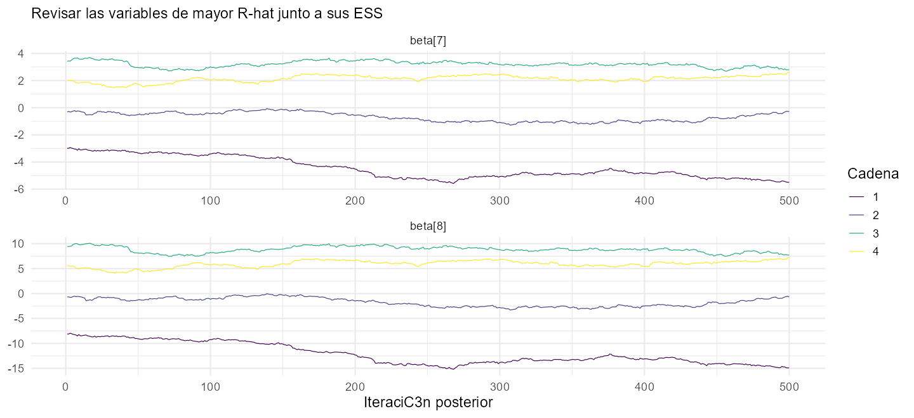
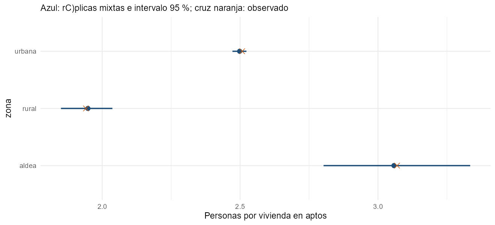
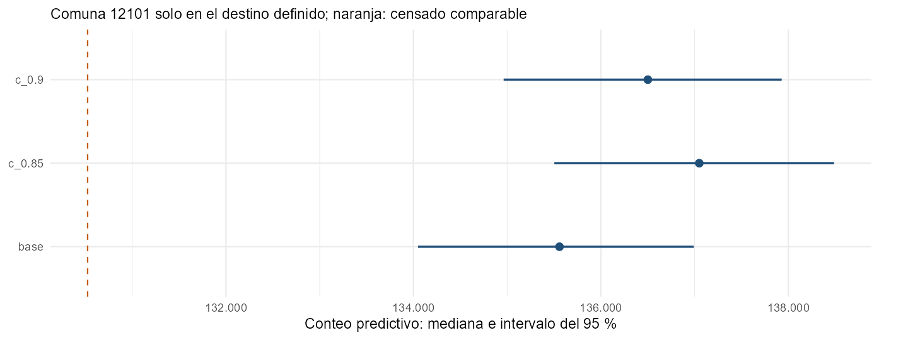

```{r setup, include=FALSE}
knitr::read_chunk("Rcode/Practica_Dia4.R")
knitr::opts_chunk$set(eval=FALSE, echo=TRUE, message=FALSE, warning=FALSE,
  comment="", fig.align="center", out.width="90%")
res <- readRDS("resultados/resumen.rds")
```

## Referencia del modelo final de Chile

Se conserva la especificación implementada: **40 covariables, zona fija y efectos de comuna**, con matrices y exposición originales.

**Estado del ajuste guardado:** presenta problemas fuertes de convergencia. Las cifras permiten reproducir y revisar el procedimiento. Su uso para inferir población queda pendiente de validación.

La sesión de diagnóstico conserva todas las alertas. Los escenarios posteriores son ejercicios de cálculo sobre esa misma referencia.


# Una decisión que se pueda explicar y reproducir

## Objetivos de la práctica

En parejas, integrarán el recorrido aprendido:

1. Revisar las cadenas y las alertas del cálculo.
2. Contrastar el modelo con los datos censales usados para ajustar.
3. Crear un escenario de exposición para una comuna elegida.
4. Agregar las predicciones y comunicar sus supuestos y limitaciones.

**Actividad:** ejecuten los bloques preparados, modifiquen entradas y expliquen sus decisiones. No basta con copiar las tablas de referencia.

## Materiales y organización

Abran `Rcode/Practica_Dia4.R` desde `Dia4_S3_Practica` y ejecuten sus bloques en orden.

| Insumo | Uso |
|---|---|
| Cadenas conservadas en D4S1 | Recalcular controles y generar predicciones |
| Destino definido en D4S2 | Llaves, covariables, comunas y exposición |
| Script de esta práctica | Diagnóstico, chequeos y escenarios personalizados |

Mantengan la estructura de carpetas de la revisión. No se vuelve a ejecutar Stan: el objetivo es utilizar y revisar el ajuste, que ya aprendieron a producir en D3S4.

## Producto por pareja

Entreguen:

- Una tabla de controles y una interpretación de las trazas.
- Un chequeo por zona o comuna, con una señal que merece revisión.
- Una comparación de escenarios para una comuna elegida.
- Una tabla de resultados agregados con su universo e intervalo.
- Una conclusión institucional de cinco líneas.

Cada resultado debe identificar el ajuste, los datos utilizados, la exposición asumida y la acción que recomiendan.

## Cargar y comprobar los insumos

```{r practica-paquetes}
```

Ejecuten `practica-insumos` y completen una ficha:

1. ¿Cuántos segmentos son aptos y cuántos están en el destino?
2. ¿Qué representan `X_tot` y `Z_tot`?
3. ¿Qué excluye el destino y por qué no equivale a toda la región?
4. ¿Qué información se coteja para evitar mezclar cadenas y matrices de ajustes distintos?

# Ejercicio 1: diagnosticar el cálculo

## Recalcular los controles con las cadenas completas

Ejecuten `practica-diagnostico`.

```r
diagnostico <- posterior::summarise_draws(draws,
  "mean", "sd", "rhat", "ess_bulk", "ess_tail", "mcse_mean")
```

Registren:

- El mayor R-hat y los menores ESS bulk y tail.
- Las divergencias y llegadas al límite de profundidad por cadena.
- Si alguna cadena presenta E-BFMI inferior a 0,3.

No retiren intercepto, efectos de comuna o escalas para obtener un resumen favorable.

## Interpretar una señal visual

Ejecuten `practica-trazas`, que selecciona las dos variables con mayor R-hat.

1. ¿Las cadenas exploran valores comparables o permanecen separadas?
2. ¿Observan una tendencia persistente o periodos largos de poca exploración?
3. Relacionen lo observado con R-hat, ESS y MCSE de esas variables.

**Decisión:** indiquen si el cálculo permite continuar la demostración o necesita revisión. 

## Referencia del ajuste provisto

```{r, eval=TRUE, echo=FALSE}
d <- res$diagnostico
knitr::kable(data.frame(Parametros=nrow(d), Rhat_max=max(d$rhat),
  ESS_bulk_min=min(d$ess_bulk), ESS_tail_min=min(d$ess_tail),
  Requieren_revision=sum(d$revisar)), digits=4)
```

{width=72%}

Estas referencias corresponden al ajuste conservado en D4S1. Si usan otras cadenas, deben diagnosticarlas de nuevo y documentar su procedencia.

# Ejercicio 2: contrastar el modelo con el censo

## Generar réplicas y escoger un grupo de comparación

Ejecuten una vez `practica-replicas`. Después ejecuten `practica-chequeos`.

```r
variable_chequeo <- "zona"
```

1. Comparen la razón personas/vivienda observada y su rango replicado para cada zona.
2. Cambien la primera línea del bloque a **`"cut"`** y vuelvan a ejecutar el bloque completo.
3. Elijan una comuna con pocos aptos y otra con más información. ¿Cómo cambia la lectura del chequeo?

Las réplicas usan las viviendas y características de los aptos, con nueva variación de segmento. No son una validación independiente.

## Leer el chequeo y justificar una revisión

{width=80%}

La cruz naranja es el dato observado; azul resume las réplicas.

Expliquen una de estas situaciones con números de su tabla:

- El dato observado queda dentro del rango replicado.
- El dato queda fuera del rango o cerca de un extremo.
- La información del grupo es escasa y la comparación resulta poco concluyente.

Ninguna situación identifica automáticamente omisión censal ni prueba que el modelo esté validado.

## Revisar también la variación entre segmentos

```{r, eval=TRUE, echo=FALSE}
knitr::kable(res$variacion, digits=3,
  col.names=c("Desviación observada", "Límite 2,5 %", "Mediana replicada", "Límite 97,5 %"))
```

1. ¿La desviación de los cocientes observados queda dentro del rango replicado?
2. ¿Por qué acertar la razón agregada por zona no garantiza reproducir toda la variación?
3. Propongan una revisión de datos o una modificación candidata de la especificación. Expliquen si exigiría volver a ajustar Stan.

::: {.notes}
Con el insumo y semillas de referencia, la variación observada queda ligeramente por debajo del rango replicado. No se presenta como prueba formal de rechazo. Revisar selección de aptos por densidad superior a uno, variables omitidas, escala y nivel de réplica. Las réplicas nuevas no vuelven a aplicar el filtro de selección observado. Una modificación de previas, covariables, agrupamiento o datos de ajuste exige un nuevo ajuste y diagnóstico; no se pide ejecutar varios modelos competidores en este ejercicio.
:::

# Ejercicio 3: construir un escenario para una comuna

## Elegir el territorio y el supuesto

Antes de elegir, consulten:

```r
table(destino$cut, destino$clasificacion_cobertura)
```

En el bloque `practica-eleccion` cambien las entradas:

```r
comuna_elegida <- "12101"
coberturas_probar <- c(0.90, 0.85)
```

El escenario modifica **solo** los segmentos clasificados como Incompleta de esa comuna; mantiene sin cambios el `V_tot` final del resto del destino.

## Realizar una modificación propia

1. Ejecuten el ejemplo y anoten cuántos segmentos pertenecen al grupo seleccionado.
2. Cambien a otra comuna con segmentos Incompleta; pueden probar **12401**.
3. Propongan otro valor válido de cobertura y justifíquenlo como hipótesis.
4. Ejecuten de nuevo el bloque completo `practica-eleccion`, después `practica-resultados` y `practica-figuras`.

Si la comuna no tiene segmentos del grupo requerido, el código se detiene. Elijan otra con la tabla anterior; no modifiquen su clasificación para poder ejecutar el ejercicio.

## Qué están modificando realmente

Se utiliza $V^{escenario}=\operatorname{round}(V^{final}/c)$.

- Los valores de cobertura son supuestos fijos de aprendizaje, no tasas estimadas.
- Se mantiene la relación aprendida entre personas, viviendas, comuna y covariables.
- Las viviendas añadidas se consideran compatibles con esa relación.
- No se incorpora incertidumbre sobre los valores de cobertura.

**Justifiquen:** ¿qué evidencia adicional necesitarían para defender ese supuesto ante otro equipo censal?

## Qué cambia y qué debe permanecer igual

Con las simulaciones y números aleatorios comunes de la práctica:

1. Los segmentos fuera del grupo seleccionado conservan exactamente su predicción.
2. La ampliación de exposición afecta solo al grupo seleccionado.
3. La agregación de todas las comunas por simulación debe reproducir el total del destino.

**Actividad:** expliquen por qué cambiar cobertura en predicción no exige otro ajuste, pero modificar `V_obs`, aptos, covariables o previas sí lo exige.

::: {.notes}
Se conserva el procedimiento predictivo de D4S2: coeficientes y efectos coherentes por draw, nueva densidad con techo, límites de intensidad y Poisson. La réplica del chequeo usa el modelo de ajuste sin techo predictivo de densidad; no confundir ambas reglas. El acoplamiento por uniformes comunes facilita la comparación y no identifica efectos causales ni la distribución de una omisión real. Se permite ejecutar explícitamente el cálculo como demostración pendiente de validación. Las alertas se conservan y sus resultados no habilitan inferencia poblacional.
:::

## Referencia: escenario de la comuna elegida

{width=82%}

Referencia generada con la comuna **`r res$comuna_elegida`** y **`r res$segmentos_grupo` segmentos** del grupo seleccionado.

Los cálculos corresponden al universo final de esa comuna y quedan pendientes de validar el muestreo. La línea naranja es el conteo censal del mismo universo.

# Ejercicio 4: agregar e informar

## Agregar una comuna dentro de cada simulación

Ejecuten `practica-agregacion` y elijan una comuna presente en los resultados.

```r
comuna_para_resumir <- "12401"
resumir(comunas_draws$base[, comuna_para_resumir])
```

1. Identifiquen media, mediana y límites del intervalo.
2. Expliquen por qué la media es aditiva y los extremos de los intervalos no lo son.
3. Comprueben que censado y predicho se refieren a los mismos segmentos.

## Comparar base y escenarios en la comuna

```{r, eval=TRUE, echo=FALSE}
t <- res$tabla_comuna
knitr::kable(t[c("escenario", "mediana", "inferior", "superior", "cambio_mediana_pct")],
  digits=c(0,0,0,0,1), col.names=c("Escenario", "Mediana", "Límite 2,5 %", "Límite 97,5 %", "Cambio frente a base (%)"),
  format.args=list(big.mark=".", decimal.mark=",", scientific=FALSE))
```

El porcentaje compara las medianas con la base. No es una estimación de omisión.

**En pareja:** expliquen qué parte del destino se modificó y por qué su cambio no equivale a aplicar esa cobertura a toda la comuna.

## Preparar una conclusión institucional

Redacten cinco líneas que incluyan:

1. Ajuste y universo que revisaron.
2. Evidencia sobre el cálculo y una señal del chequeo.
3. Comuna, segmentos modificados y cobertura supuesta.
4. Resultado agregado e intervalo, con comparación coherente.
5. Una limitación y una acción antes de una aplicación institucional.

No elijan el escenario solo porque se acerque más al conteo censal o produzca un intervalo más estrecho.

## Una lectura orientativa para discutir

«Los controles detectan problemas fuertes de convergencia en el ajuste final. Podemos reproducir los cálculos como ejercicio, pero sus cifras no sustentan inferencia poblacional validada. El escenario modifica V_tot final en un grupo definido mediante un factor adicional hipotético. Antes de utilizar resultados debemos revisar el muestreo y la colinealidad, justificar la exposición y validar el modelo y los universos.»

Añadan sus números y una acción concreta. Eviten presentar esta lectura como una validación ya realizada o una cifra oficial de población.

## Guardar y entregar

Ejecuten `practica-guardar` después de su última modificación.

Se guardan tablas de diagnóstico, chequeos, escenarios y resultados por segmento. Los totales por simulación se conservan para verificar las agregaciones.

Entreguen además su nota institucional y registren la comuna y coberturas que eligieron. Una modificación de entradas debe ir acompañada de una nueva interpretación, no solo de otra tabla.

::: {.notes}
Esta revisión reemplaza los ejercicios obligatorios de SVD/correlaciones de muchas covariables, ajuste histórico con Q=1 y especificación corregida por una práctica integradora coherente con D3S3/D3S4/D4S1/D4S2. El original Taller/Dia4_S3_Practica y sus scripts/modelos se conservan intactos como apoyo técnico avanzado. No se afirma ejecutar una validación fuera de muestra ni una estimación de cobertura. La sesión requiere las carpetas D4S1 y D4S2 de esta revisión; no duplica cadenas, bases nacionales ni modelos Stan.
:::

## Muchas gracias

**Andrés Gutiérrez · Stalyn Guerrero**

**Contacto: Andrés Gutiérrez**  
[andres.gutierrez@cepal.org](mailto:andres.gutierrez@cepal.org)
